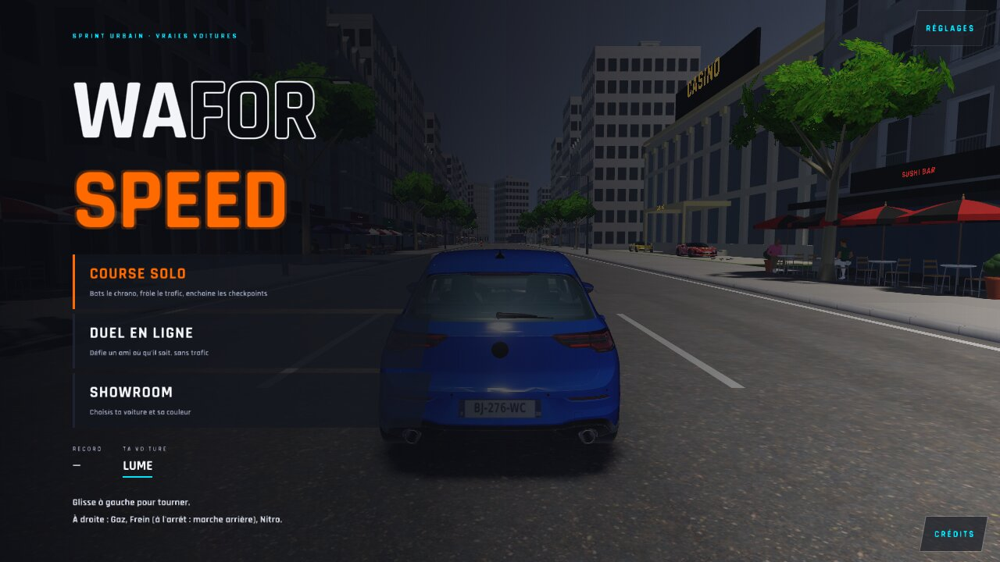
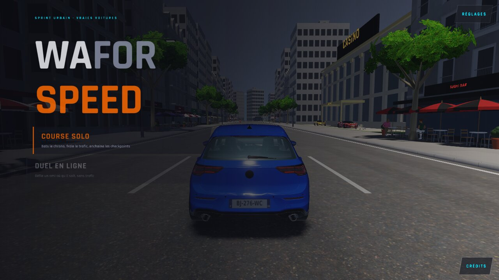
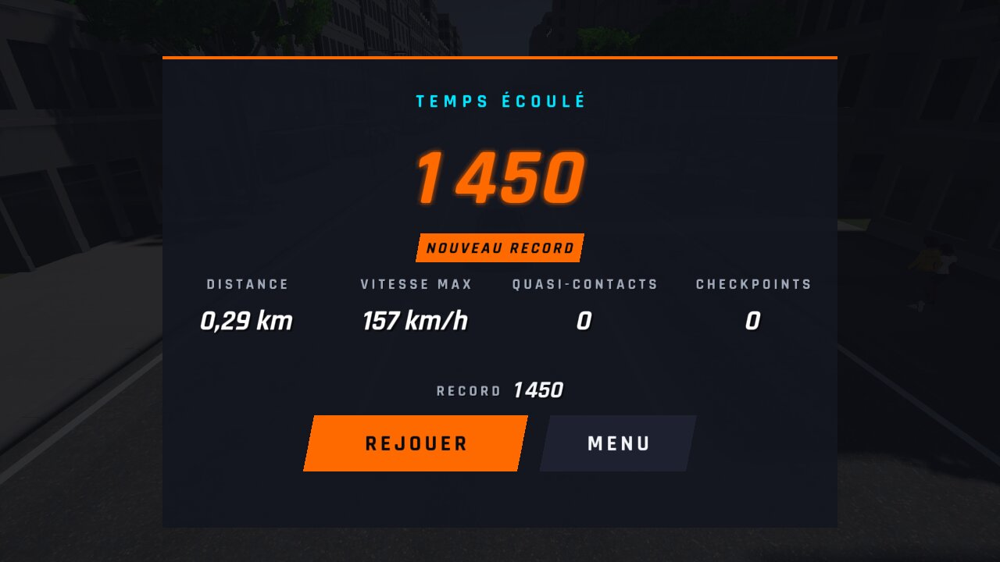
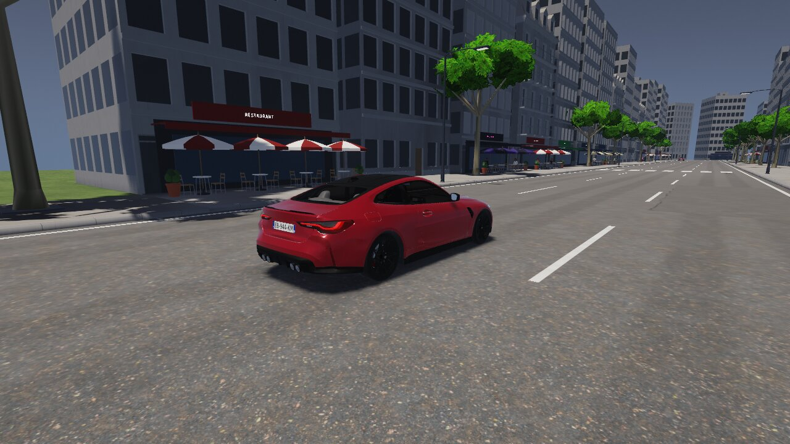

# WFS-480 — captures avant / après (tools/qa/captures_pr.sh)

Branche `feature/waforspeed-480` comparée à `origin/main` ; bancs : sauvegarde:1280x720 sauvegarde:1280x720 menu1:1280x720 ; filtre : `@(fin-record|sauvegarde-relue|menu-0|menu-anim)`.

| Capture | Avant (main) | Après (branche) |
|---|---|---|
| `menu-0` |  |  |
| `menu-anim` |  |  |
| `fin-record` |  |  |
| `sauvegarde-relue` |  |  |
