# WFS-481 — captures (tools/qa/captures_pr.sh, banc creation:2400x1080, WFS_LANGUE=fr puis en, SANS_AVANT=1)

| Capture | Avant (main) | Après (branche) |
|---|---|---|
| `creation-en-vide` | — | 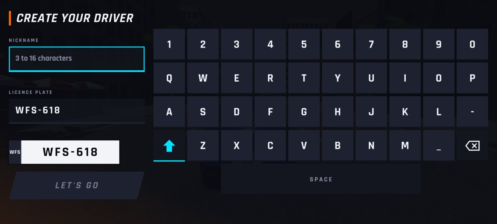 |
| `creation-fr-vide` | — | 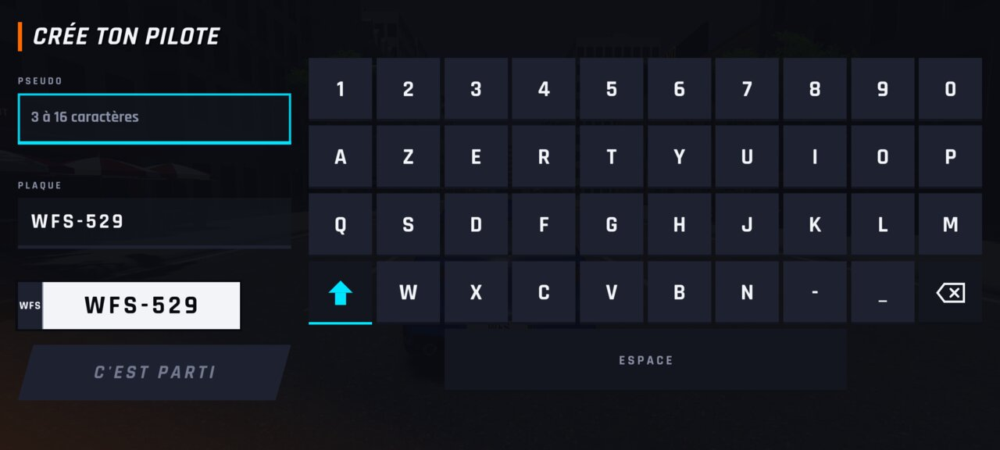 |
| `creation-en-court` | — |  |
| `creation-fr-court` | — | 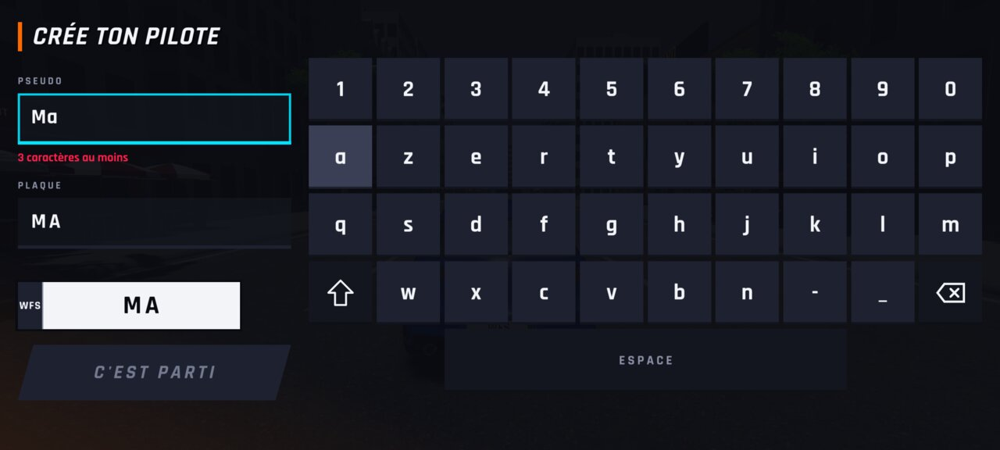 |
| `creation-fr-interdit` | — | 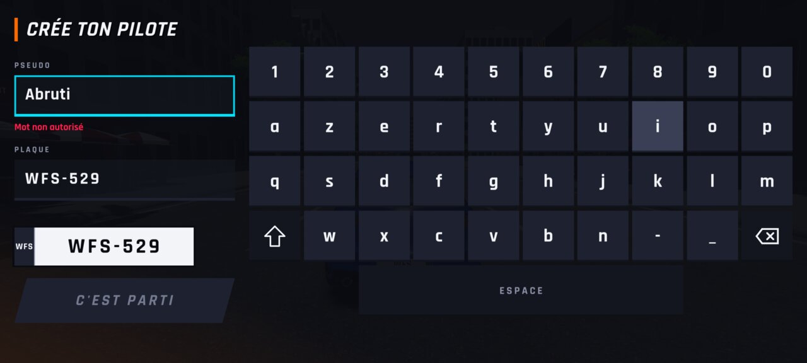 |
| `creation-en-rempli` | — | 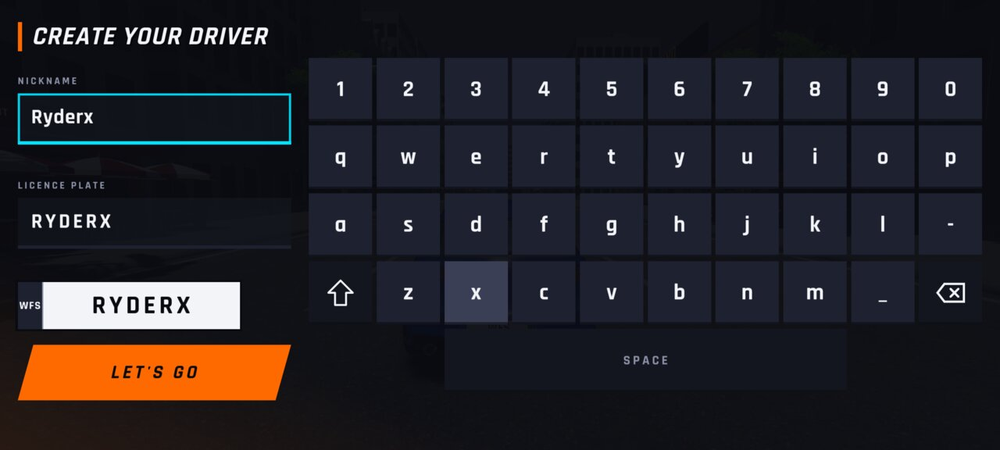 |
| `creation-fr-rempli` | — | 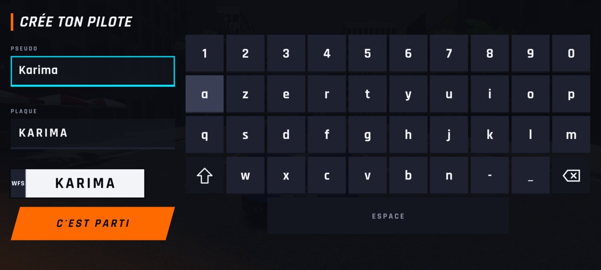 |
| `creation-en-plaque` | — | 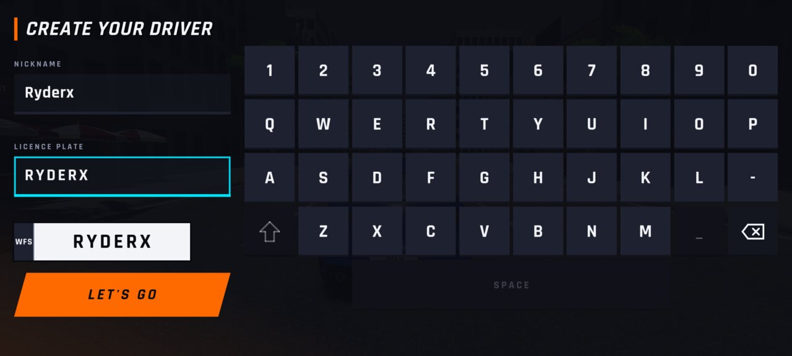 |
| `creation-en-menu` | — | 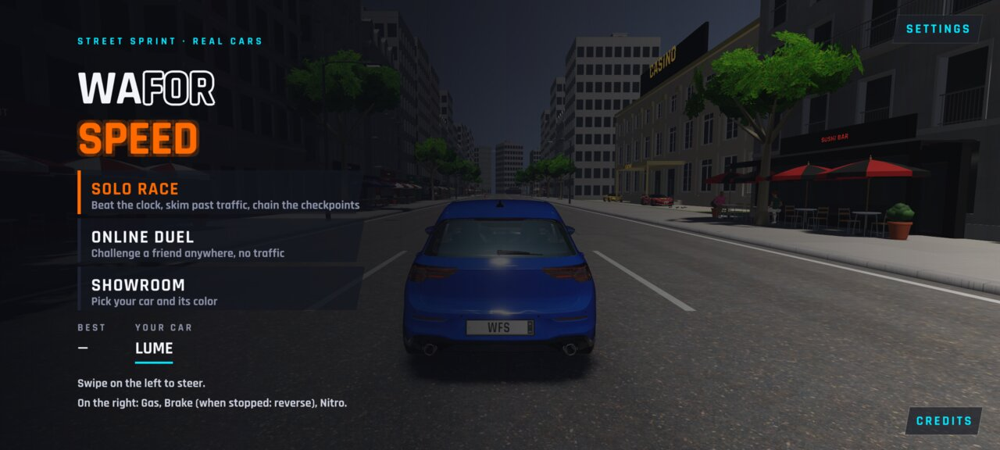 |
| `creation-fr-menu` | — | 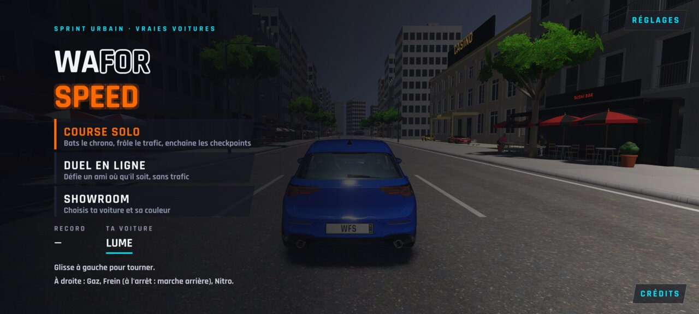 |
| `creation-en-installe` | — | 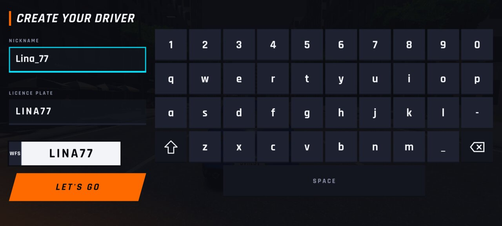 |
| `creation-fr-installe` | — | 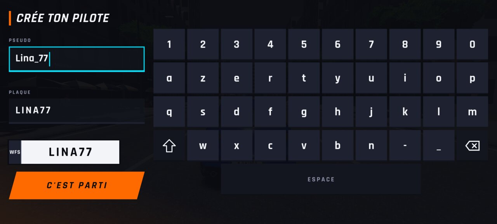 |
