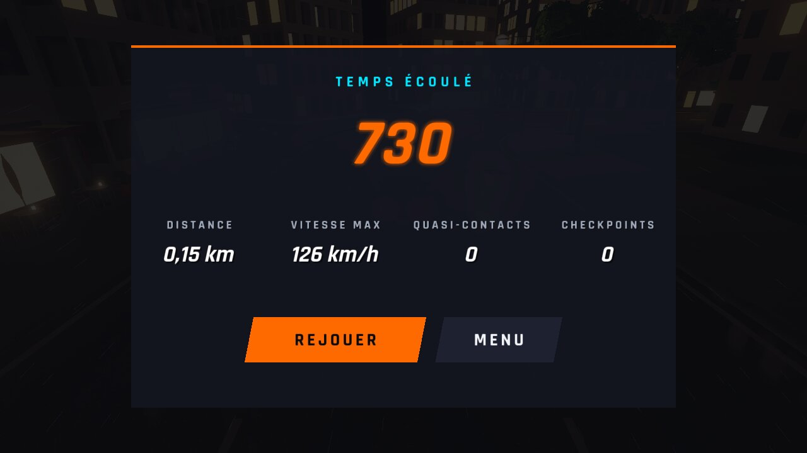
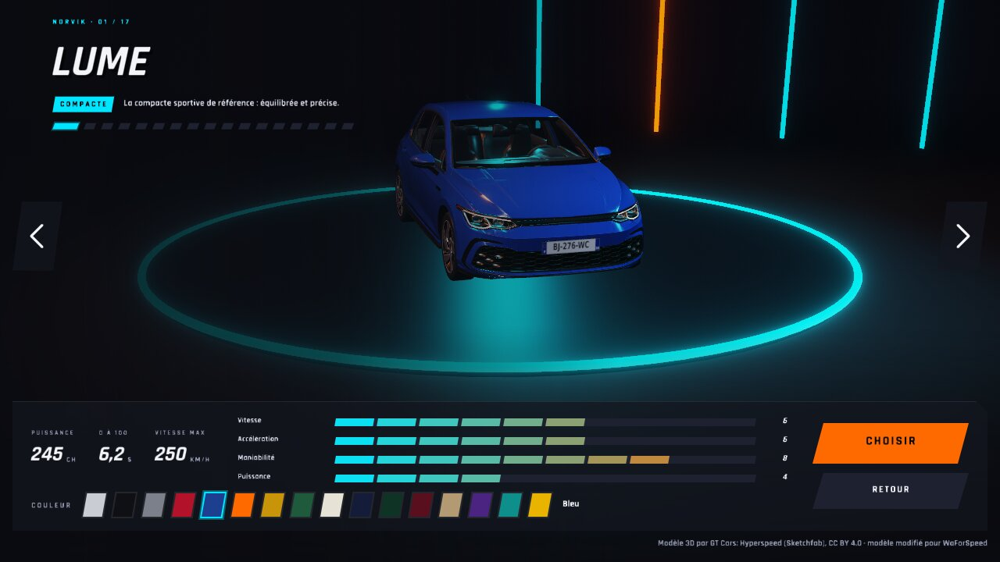
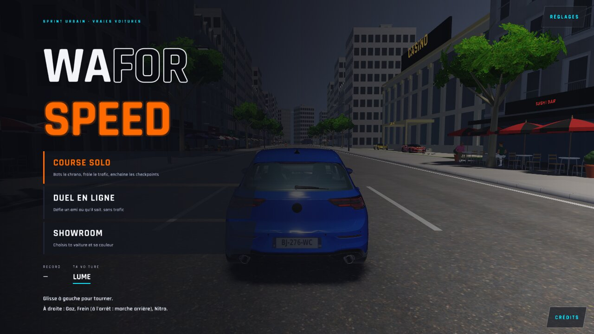
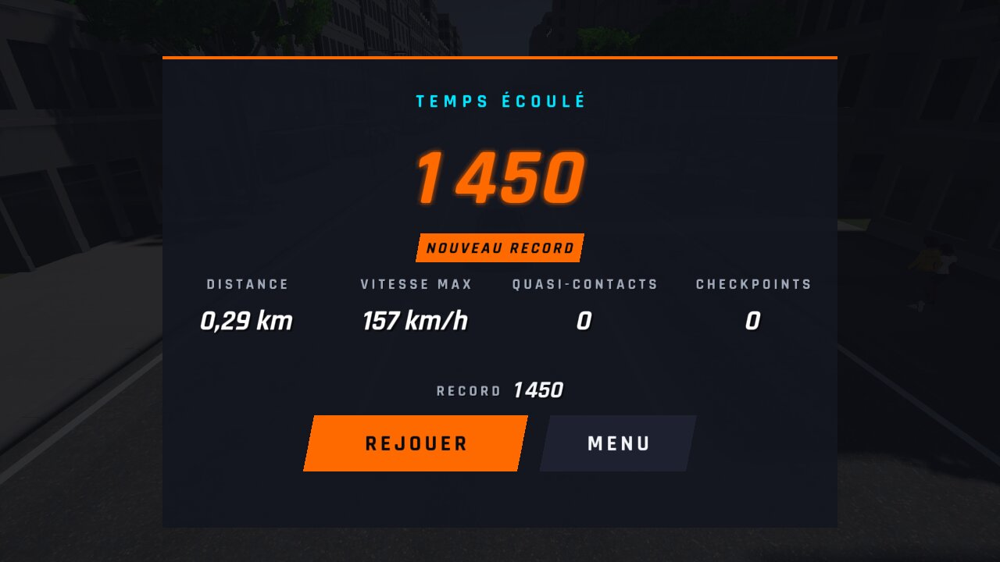
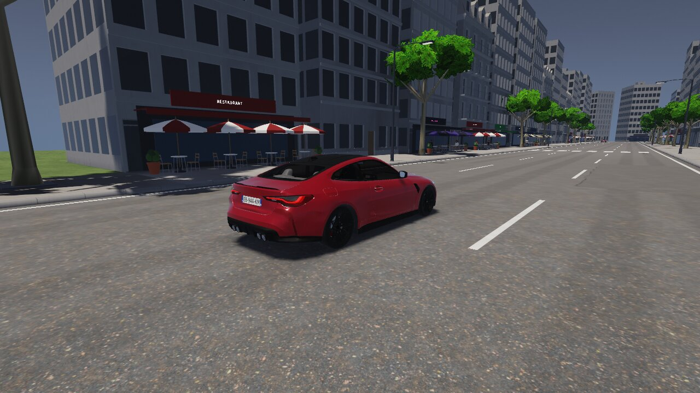

# WFS-485 — captures avant / après (tools/qa/captures_pr.sh)

Branche `feature/waforspeed-485` comparée à `origin/main` ; bancs : sauvegarde sauvegarde menu1:1280x720 ; filtre : `*`.

| Capture | Avant (main) | Après (branche) |
|---|---|---|
| `fin-menu` |  |  |
| `garage-0` |  |  |
| `menu-0` |  |  |
| `terrain-0` |  |  |
| `fin-record` |  |  |
| `sauvegarde-relue` |  |  |
