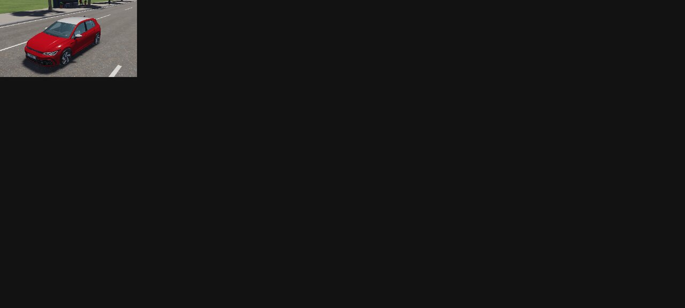
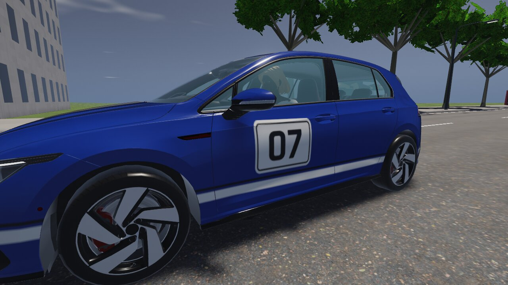
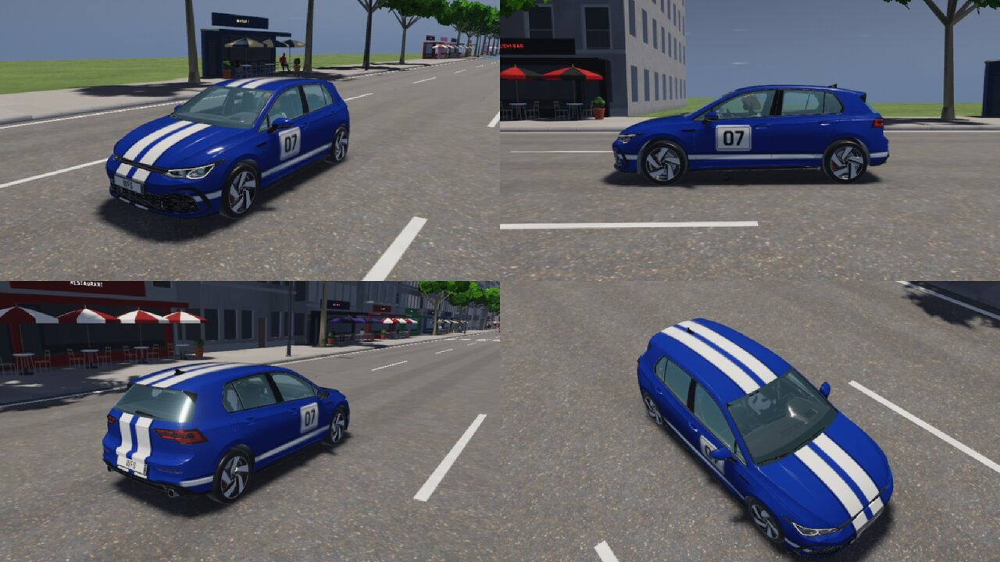
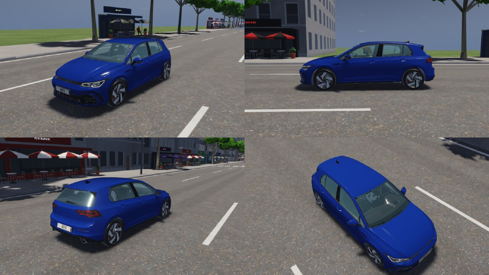
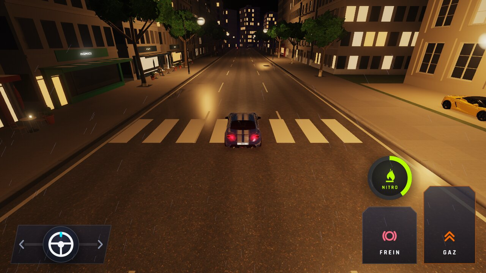
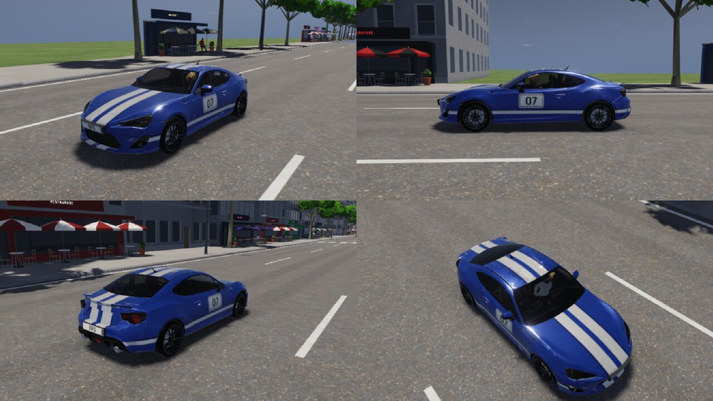
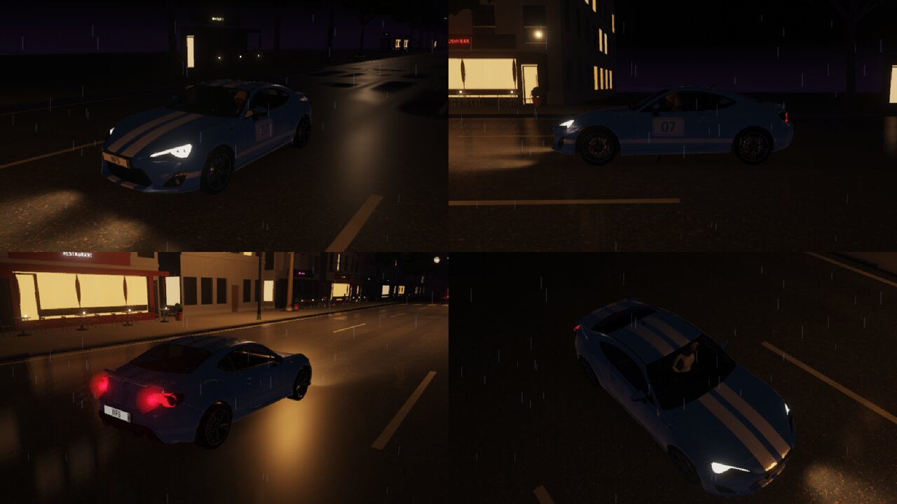
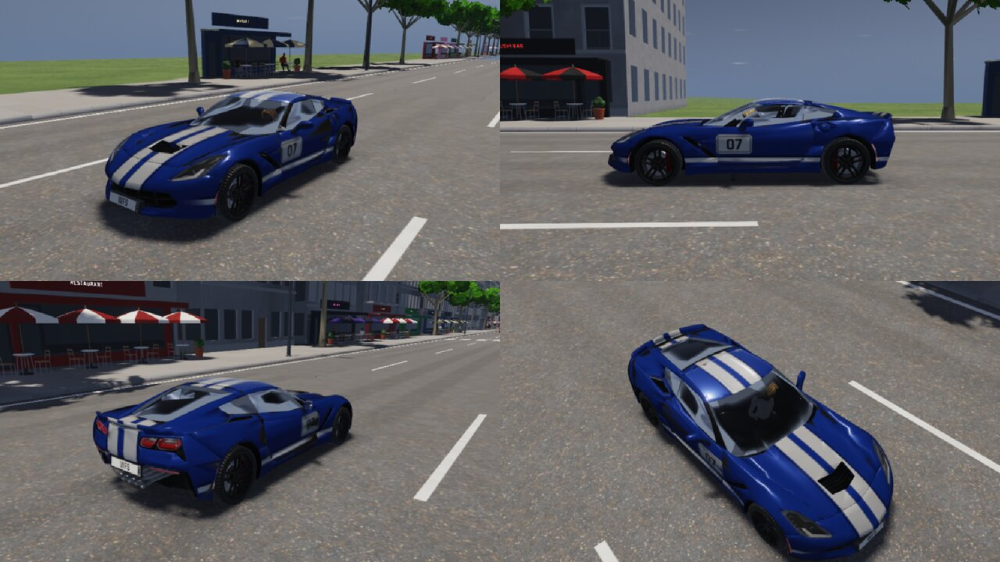

# WFS-492 — captures avant / après (tools/qa/captures_pr.sh)

Branche `feature/waforspeed-492` comparée à `origin/main` ; bancs : skins peinture2 ; filtre : `*`.

| Capture | Avant (main) | Après (branche) |
|---|---|---|
| `peinture2-planche` |  |  |
| `skins-abarth-jour` | — |  |
| `skins-giulia-course-jour` | — |  |
| `skins-giulia-course-nuit` | — |  |
| `skins-giulia-jour` | — |  |
| `skins-giulia-nuit` | — |  |
| `skins-golf-course-jour` | — |  |
| `skins-golf-course-nuit` | — |  |
| `skins-golf-jonction` | — |  |
| `skins-golf-jour` | — |  |
| `skins-golf-nuit` | — |  |
| `skins-golf-sans` | — |  |
| `skins-gt86-course-jour` | — |  |
| `skins-gt86-course-nuit` | — |  |
| `skins-gt86-jour` | — |  |
| `skins-gt86-nuit` | — |  |
| `skins-mustang-jour` | — |  |
| `skins-p208-jour` | — |  |
