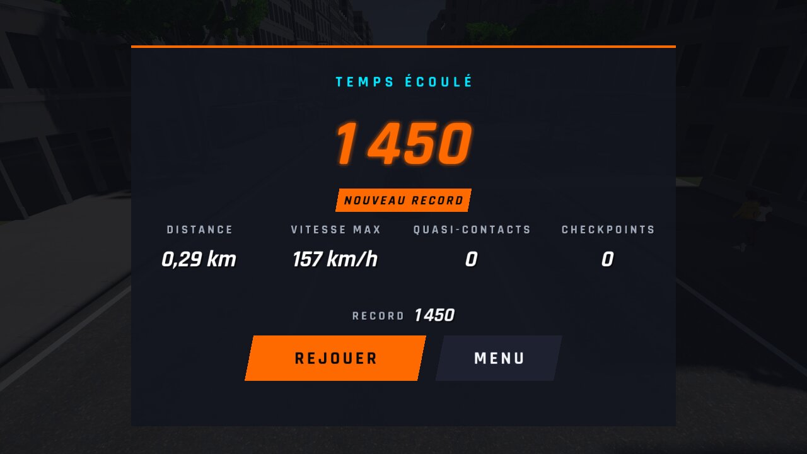
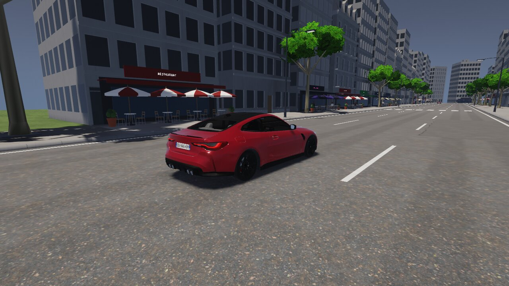
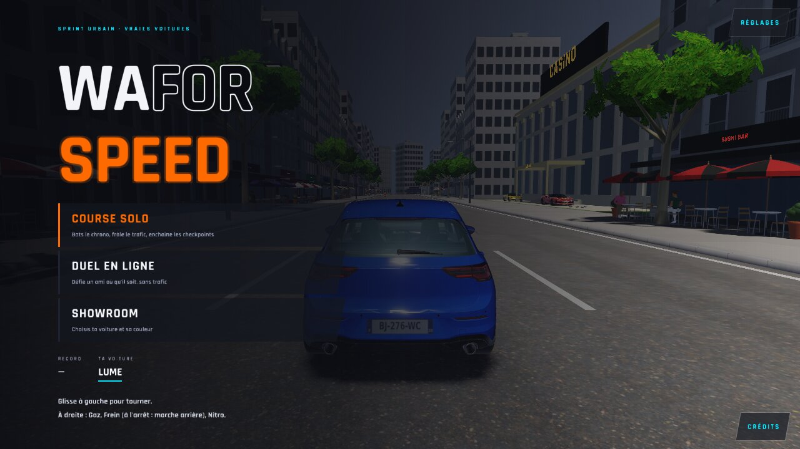
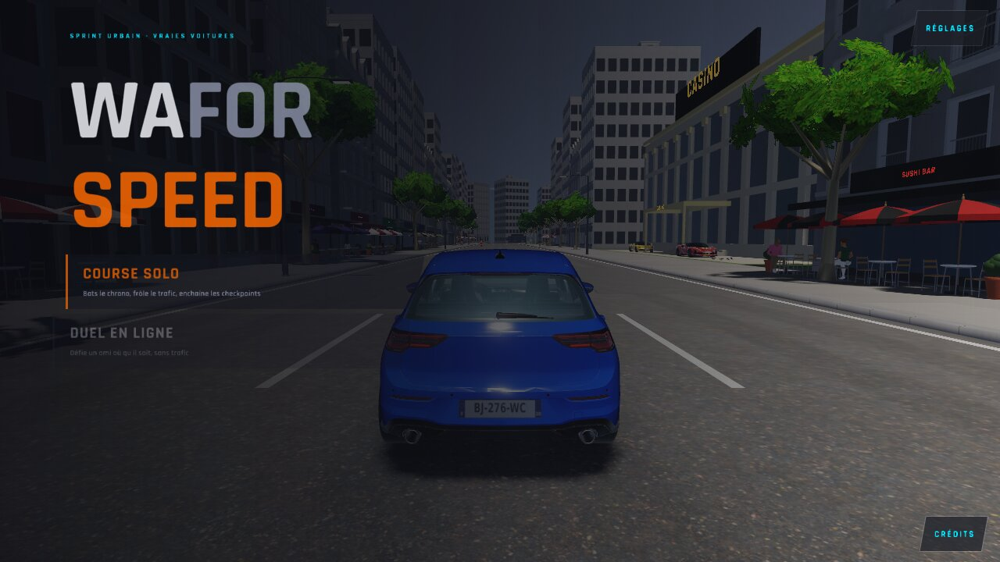
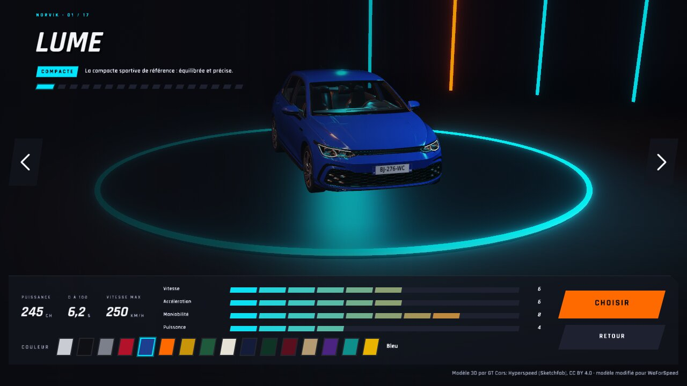
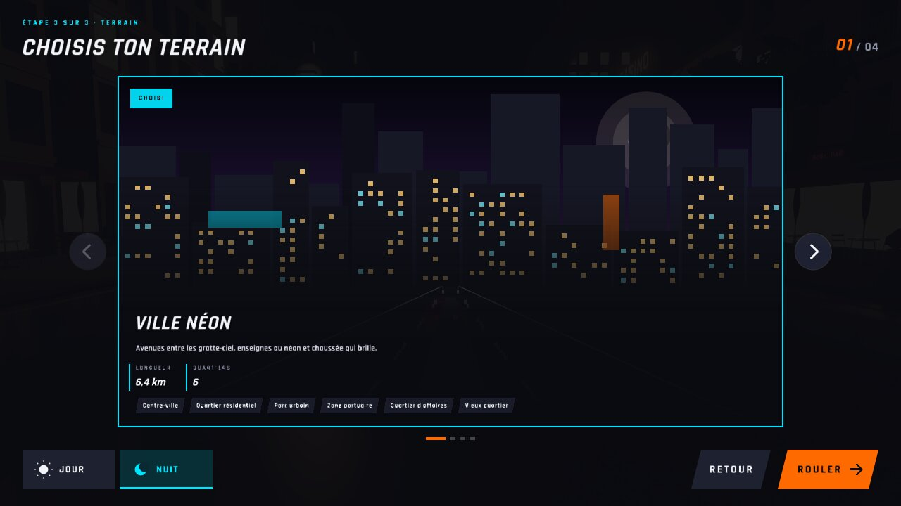
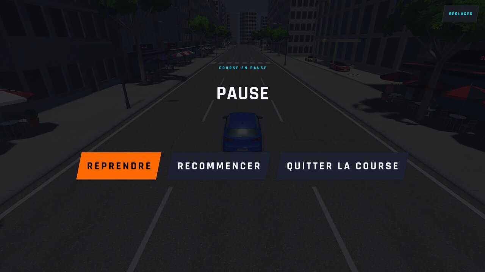
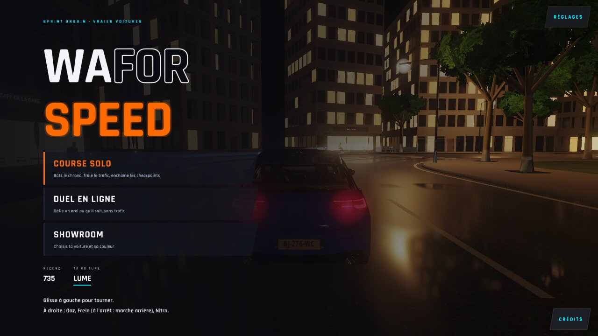

# WFS-500 — captures avant / après

Bancs `sauvegarde` (×2) et `menu1` (1280x720) ; 40 paires comparées au pixel : `texte-pixels.md` (0 pixel différent).

| Capture | Avant (main) | Après (branche) |
|---|---|---|
| `fin-record` (banc `sauvegarde`, 1er lancement (cadeau ouvert dans ce lancement)) |  |  |
| `sauvegarde-relue` (banc `sauvegarde`, 2e lancement (clés `cadeau-*` relues)) |  |  |
| `menu-0` (menu principal) |  |  |
| `menu-anim` (menu principal, animation) |  |  |
| `garage-0` (garage) |  |  |
| `terrain-0` (choix du terrain) |  |  |
| `pause-0` (pause) |  |  |
| `fin-retour-menu` (retour au menu après la course) |  |  |
