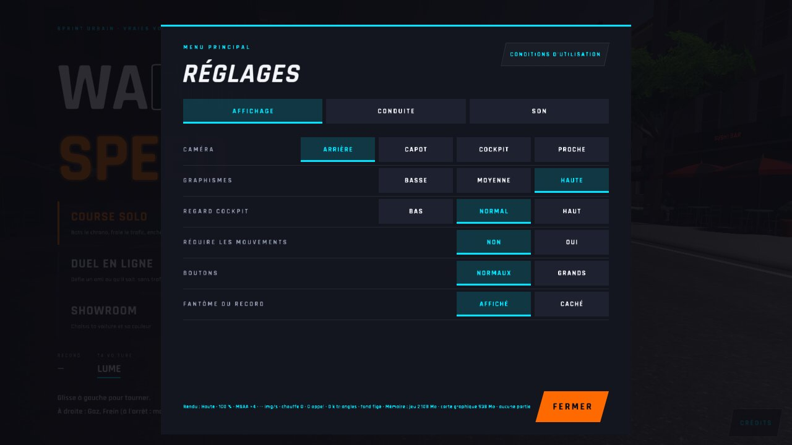
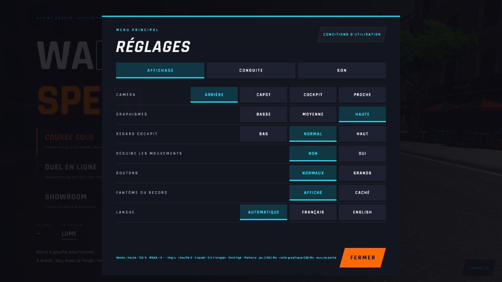
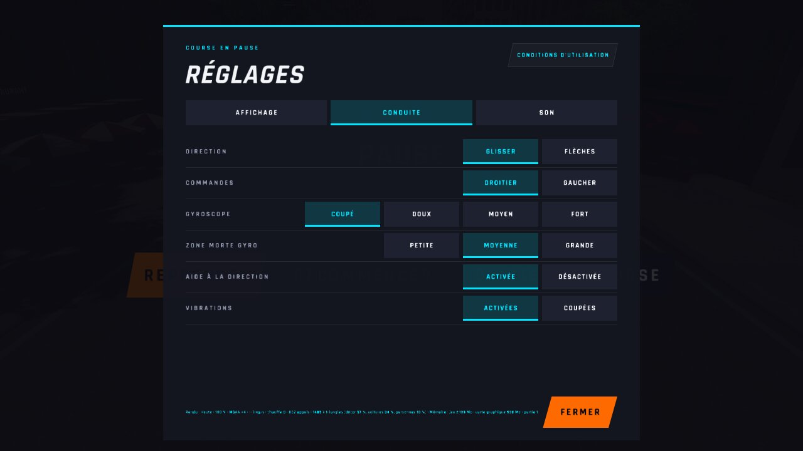
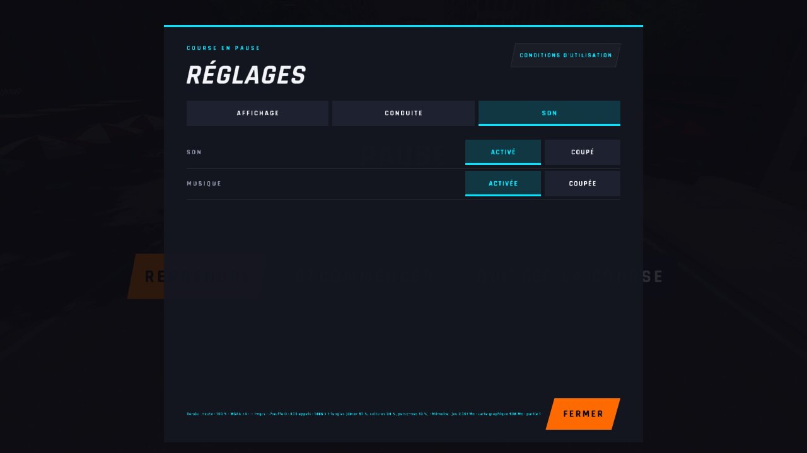
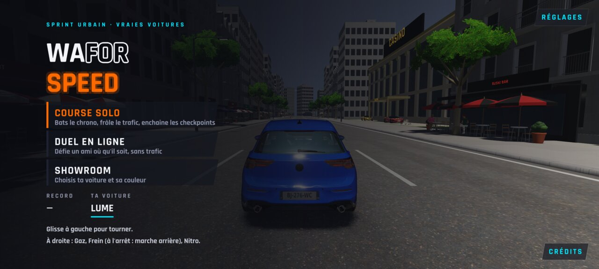
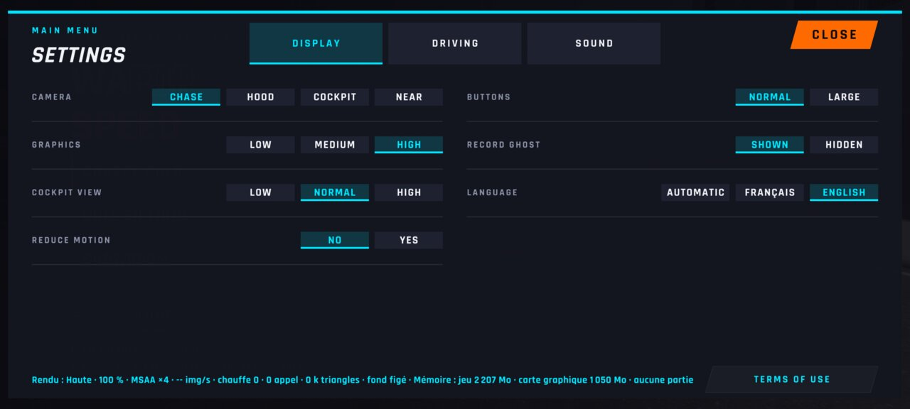
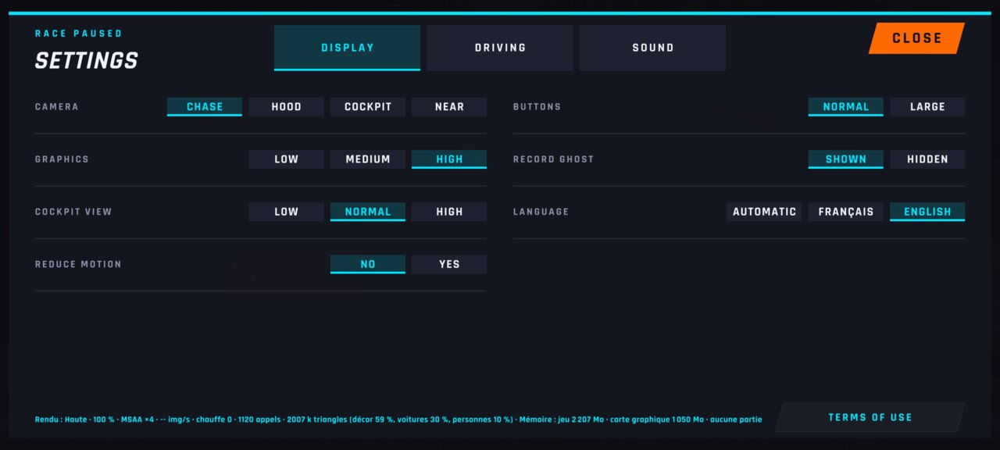
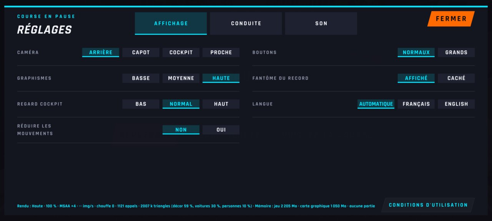
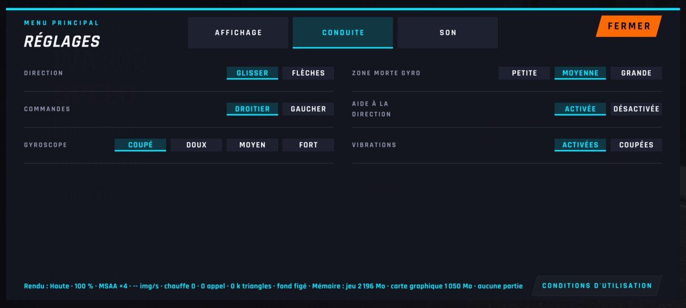
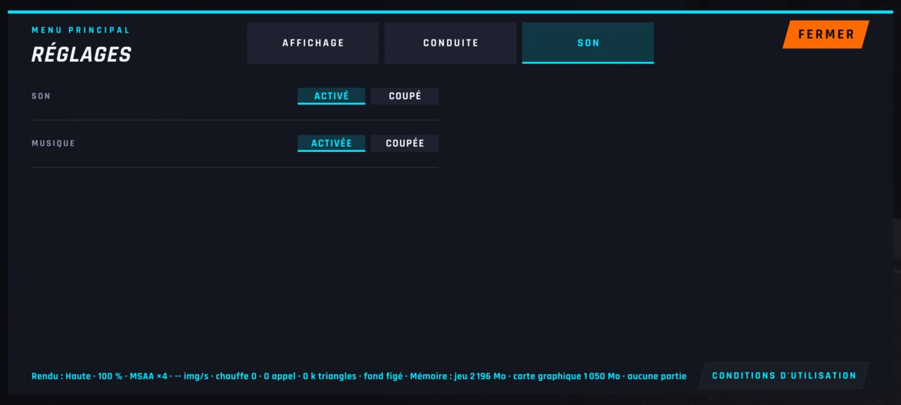

# WFS-504 — captures avant / après (tools/qa/captures_pr.sh)

Branche `feature/waforspeed-504` comparée à `origin/main` ; bancs : reglages-onglets textes textes:2400x1080 ; filtre : `*`.

| Capture | Avant (main) | Après (branche) |
|---|---|---|
| `reglages-onglet-affichage-menu` |  |  |
| `reglages-onglet-conduite-pause` |  |  |
| `reglages-onglet-son-gaucher` |  |  |
| `reglages-onglet-son-pause` |  |  |
| `textes-fr-menu` | — |  |
| `textes-fr-parcours-1-english` | — |  |
| `textes-fr-parcours-2-pause-english` | — |  |
| `textes-fr-parcours-3-auto` | — |  |
| `textes-fr-reglages-affichage` | — |  |
| `textes-fr-reglages-conduite` | — |  |
| `textes-fr-reglages-pause` | — |  |
| `textes-fr-reglages-son` | — |  |
