# WFS-510 — captures avant / après (tools/qa/captures_pr.sh)

Branche `feature/waforspeed-510` comparée à `origin/main` ; bancs : garage:1280x720 sauvegarde:1280x720 sauvegarde:1280x720 ; filtre : `*`.

| Capture | Avant (main) | Après (branche) |
|---|---|---|
| `course-p911-gris` |  | 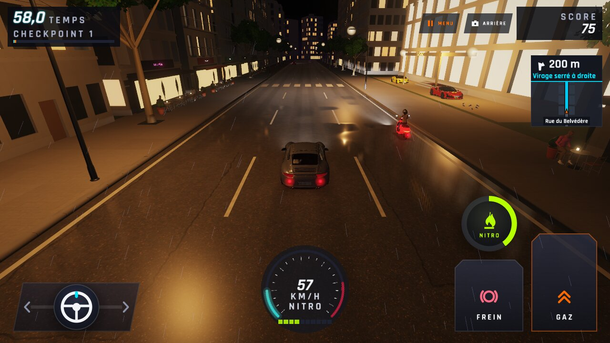 |
| `garage-0` | 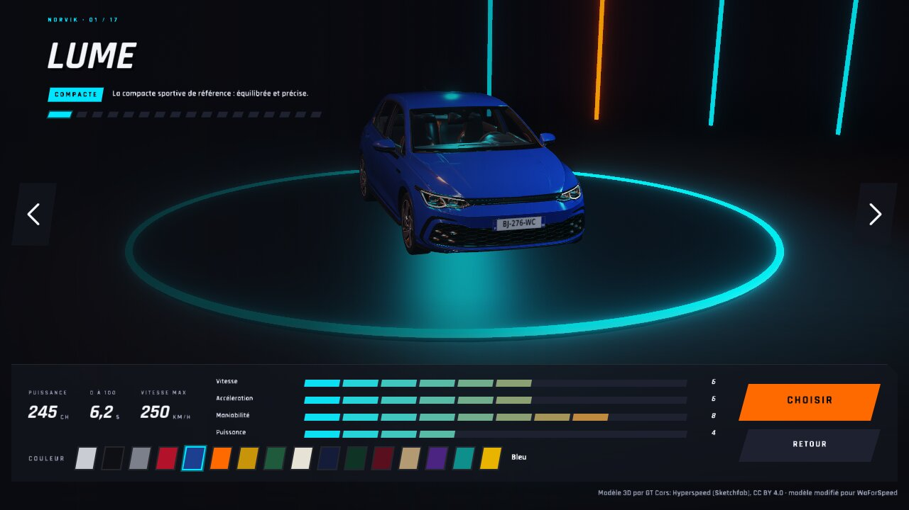 |  |
| `garage-1` | 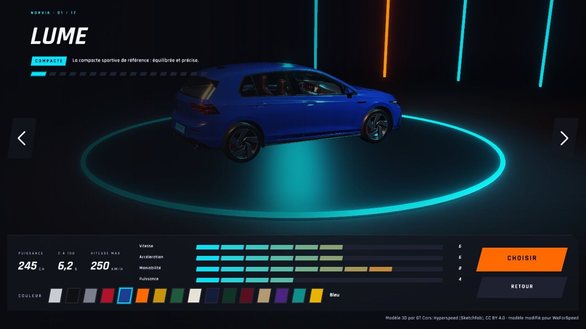 |  |
| `garage-2` |  | 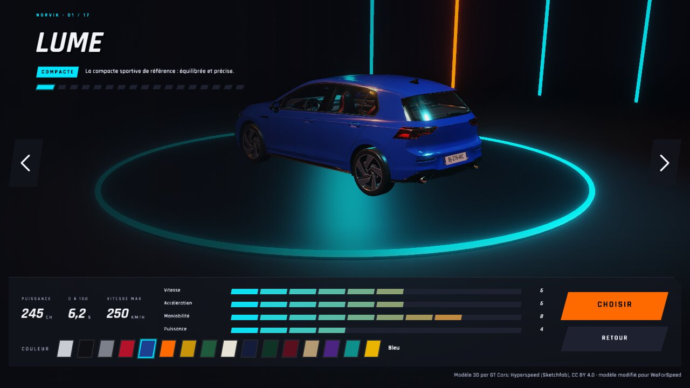 |
| `garage-course` | 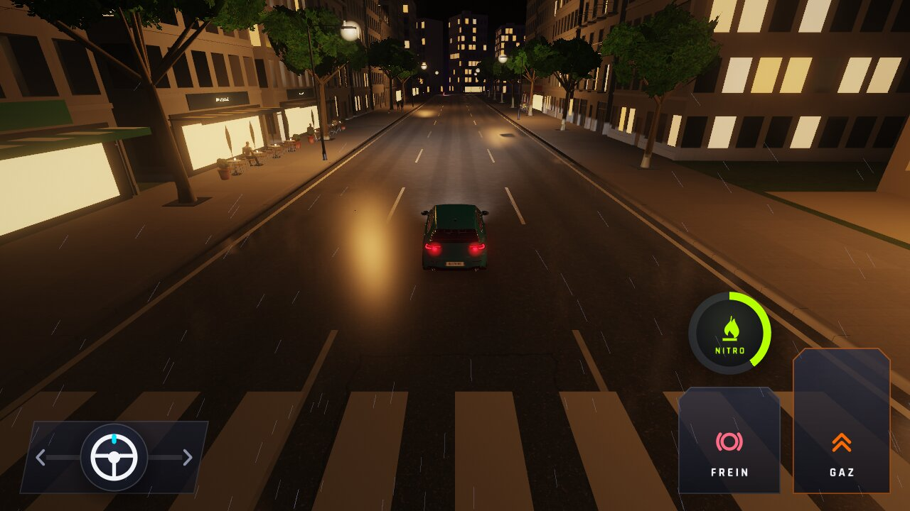 |  |
| `garage-m4` | 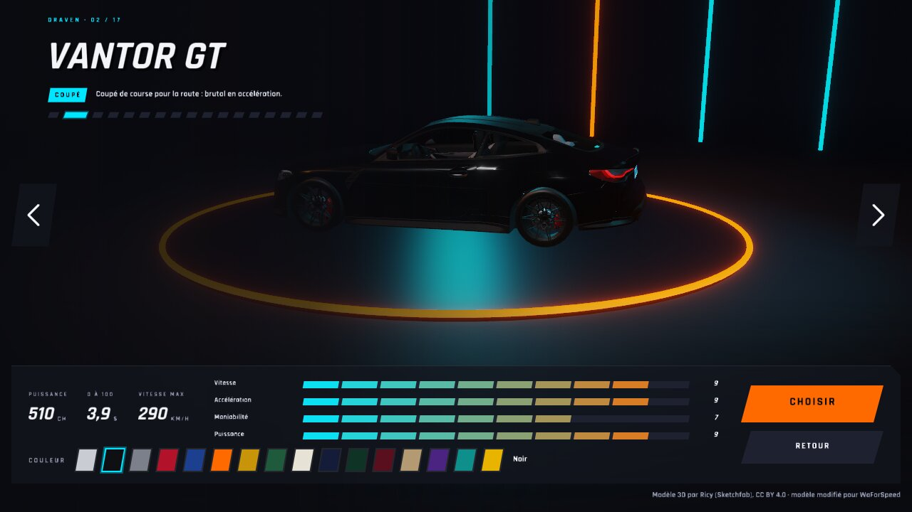 |  |
| `garage-peinture-0` | 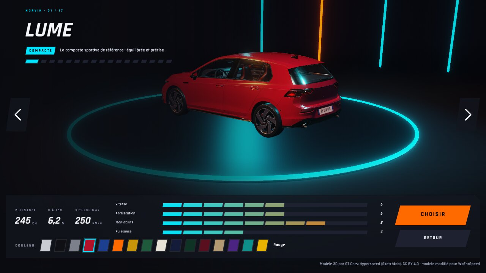 |  |
| `garage-peinture-1` |  | 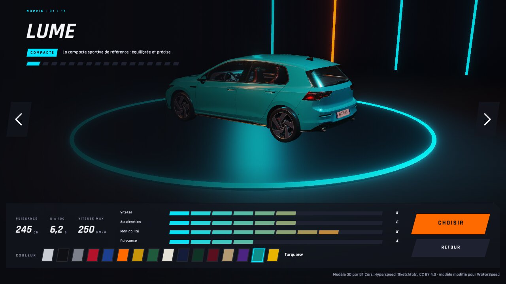 |
| `garage-peintures-p911` | 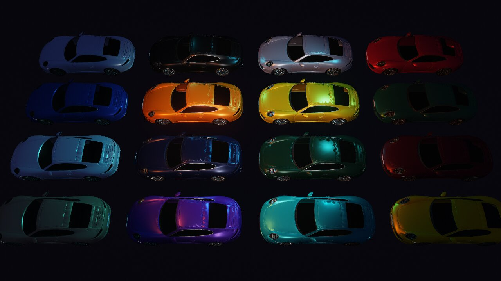 |  |
| `garage-peintures` | 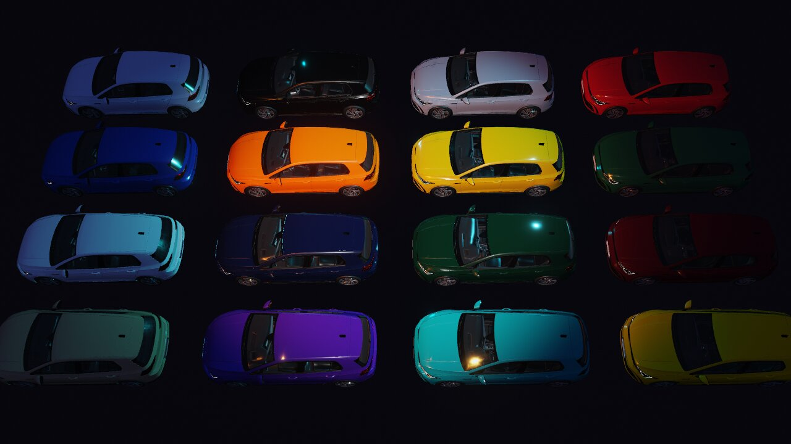 |  |
| `garage-suivant` | 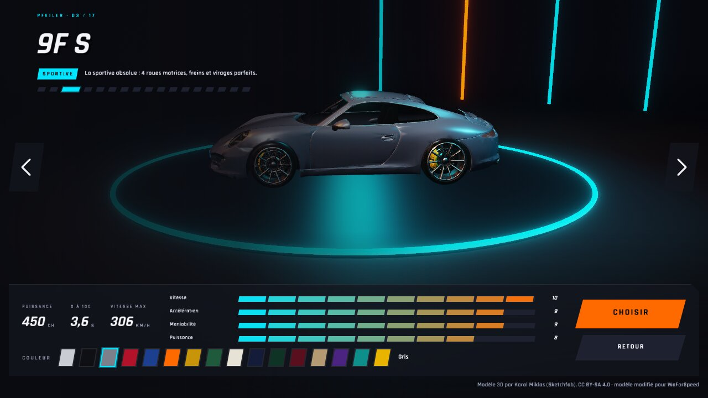 |  |
| `showroom-suivante-1` | 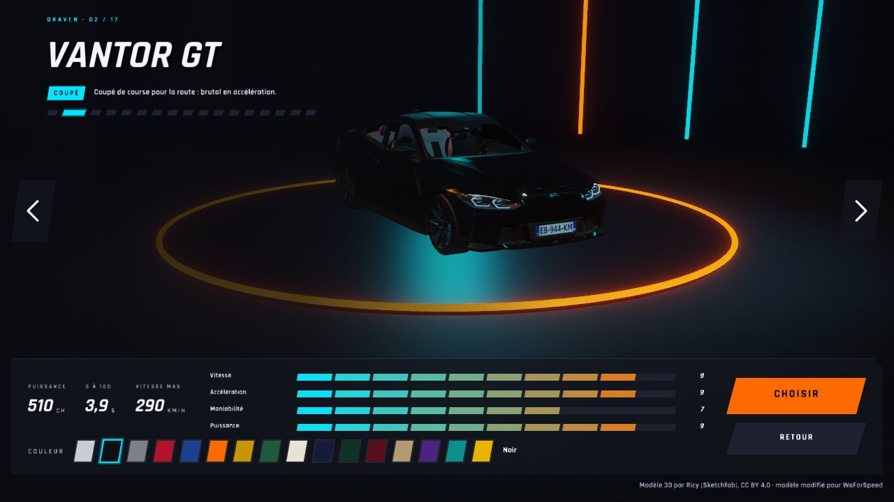 |  |
| `showroom-suivante-2` |  | 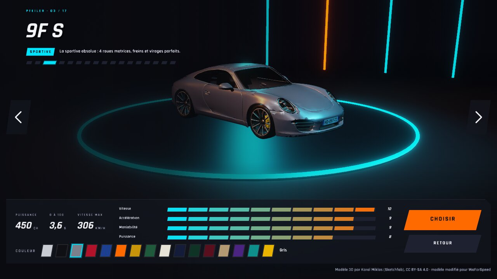 |
| `showroom-suivante-3` | 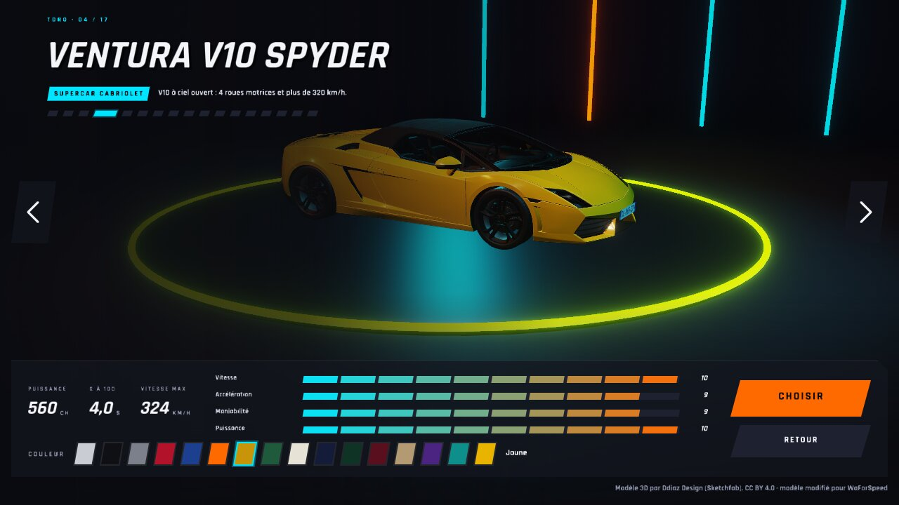 |  |
| `fin-record` | 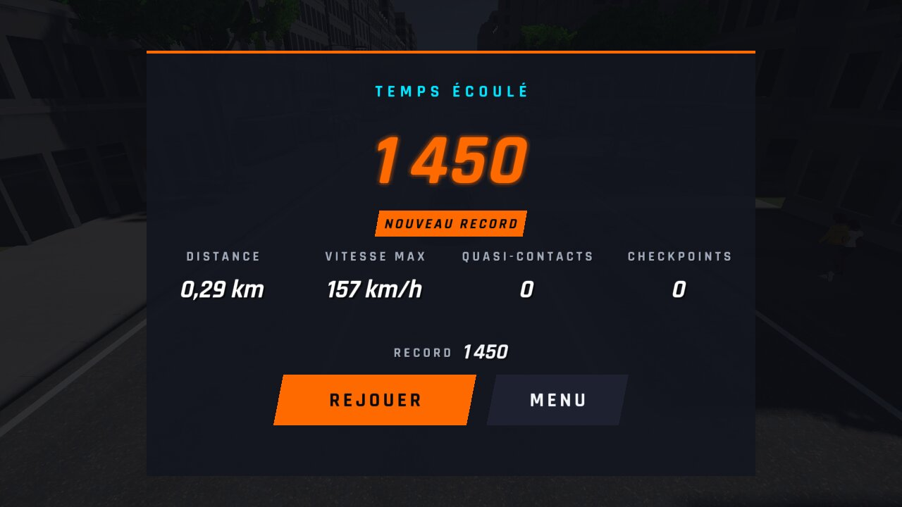 |  |
| `sauvegarde-relue` | 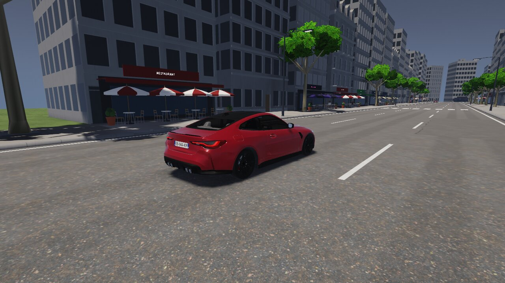 |  |
