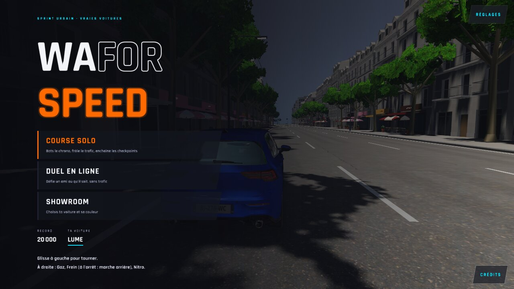
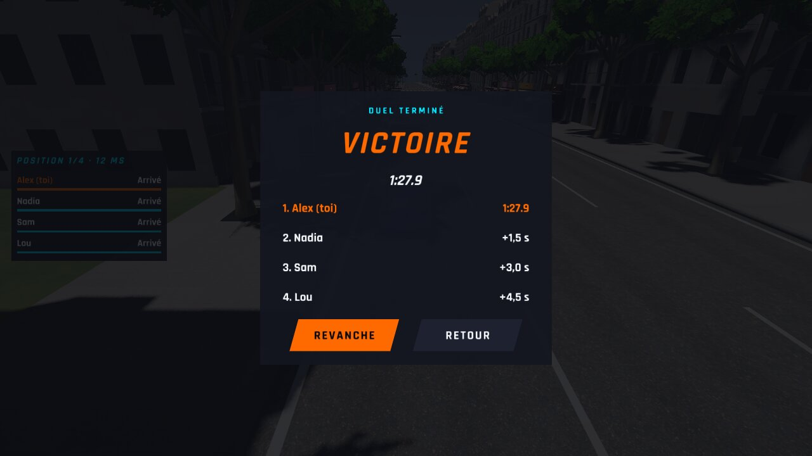
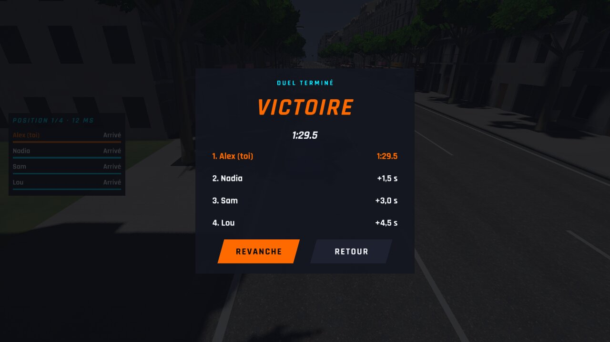
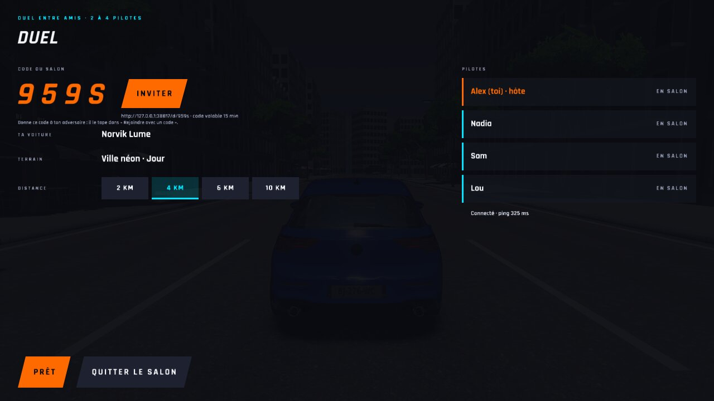
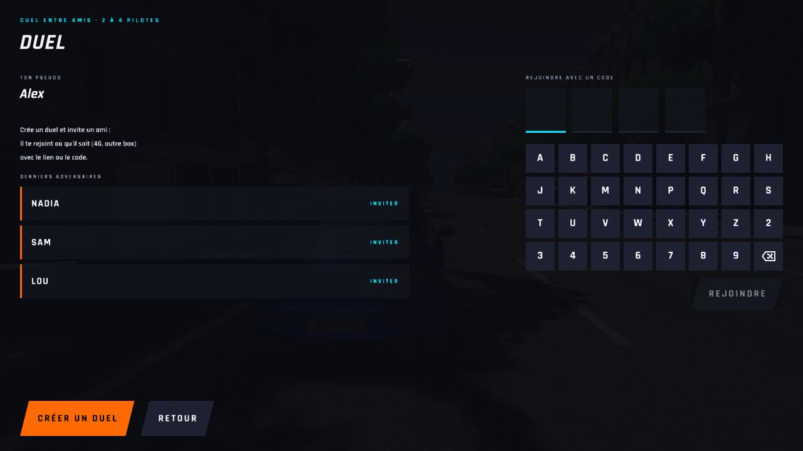
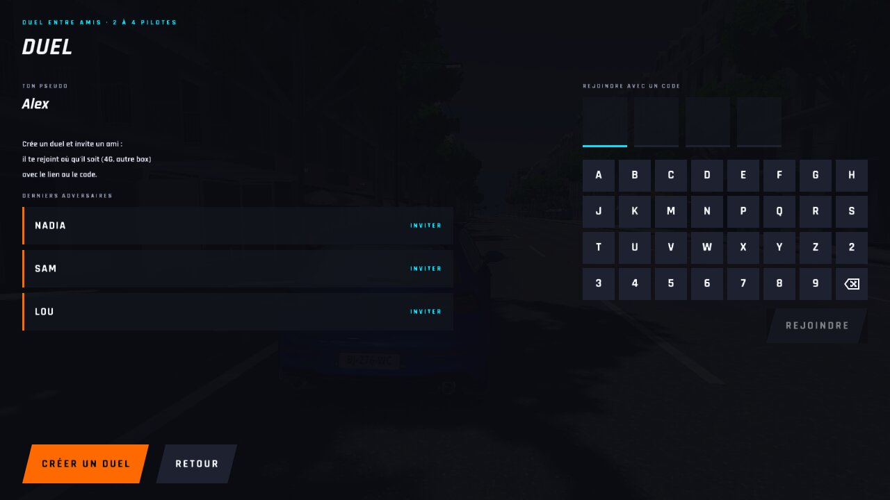
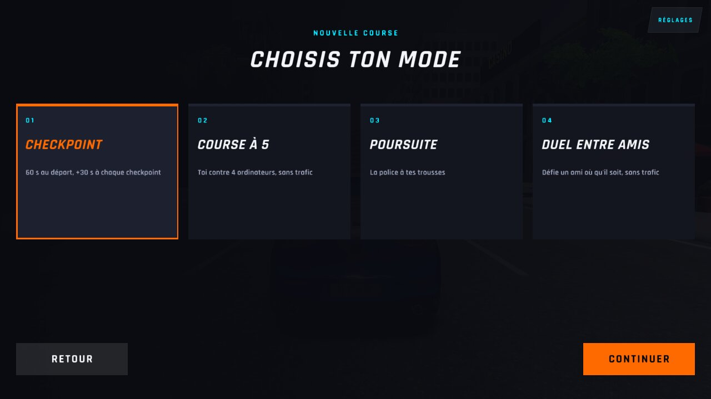
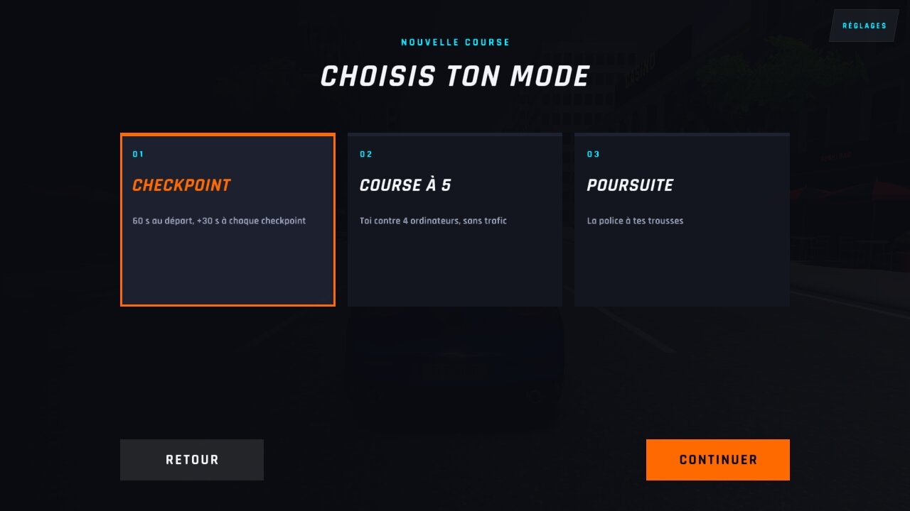

# WFS-517 — captures avant / après (tools/qa/captures_pr.sh)

Branche `feature/waforspeed-517` comparée à `origin/main` ; bancs : parcours:1280x720 menu2:1280x720 ; filtre : `@(parcours-mode*|salon-amis|salon-amis-fin|duel-retour-menu|salon-derniers)`.

| Capture | Avant (main) | Après (branche) |
|---|---|---|
| `duel-retour-menu` | — |  |
| `salon-amis-fin` |  |  |
| `salon-amis` |  |  |
| `salon-derniers` |  |  |
| `parcours-mode-3-cartes` | — |  |
| `parcours-mode` |  |  |
| `parcours-mode-3-cartes` | — |  |
| `parcours-mode` |  |  |
