# WFS-541 — captures avant / après (tools/qa/captures_pr.sh)

Branche `feature/waforspeed-541` comparée à `origin/main` ; bancs : trafic-541:1280x720 ; filtre : `*`.

| Capture | Avant (banc avec WFS_AVANT_541=1 : trafic de main) | Après (branche) |
|---|---|---|
| `trafic541-bouchon-00` |  | 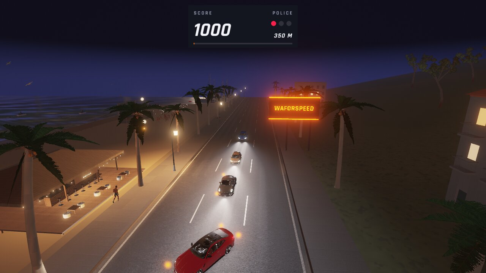 |
| `trafic541-bouchon-01` |  |  |
| `trafic541-bouchon-02` |  |  |
| `trafic541-bouchon-03` | 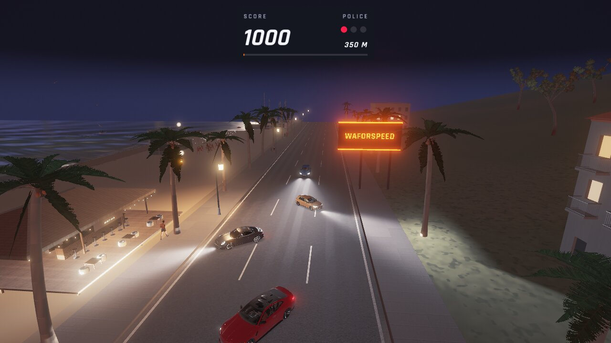 |  |
| `trafic541-bouchon-04` |  |  |
| `trafic541-bouchon-05` | 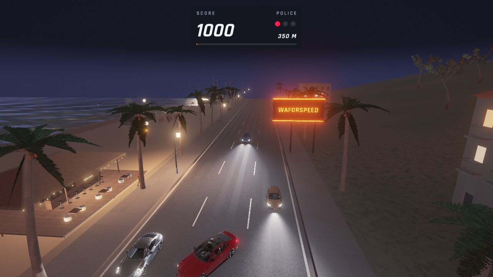 |  |
| `trafic541-bouchon-06` |  |  |
| `trafic541-bouchon-07` |  |  |
| `trafic541-bouchon-08` | 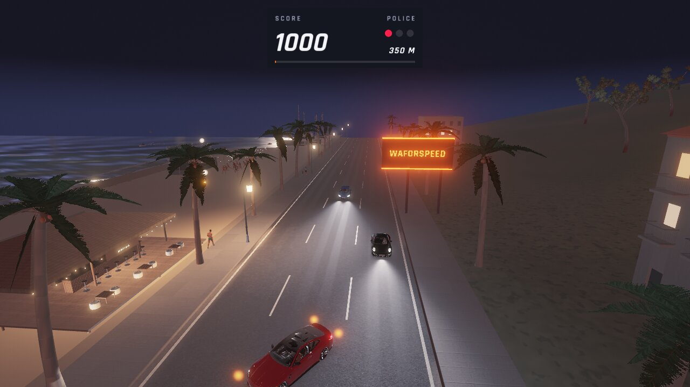 |  |
| `trafic541-bouchon-09` | 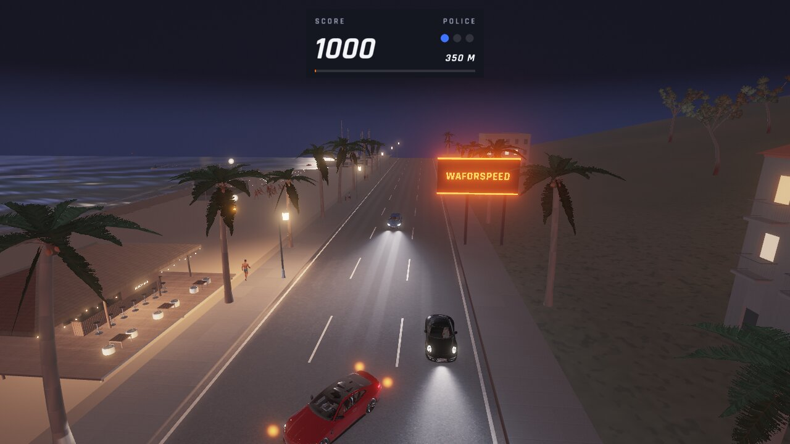 |  |
| `trafic541-pres-00` | 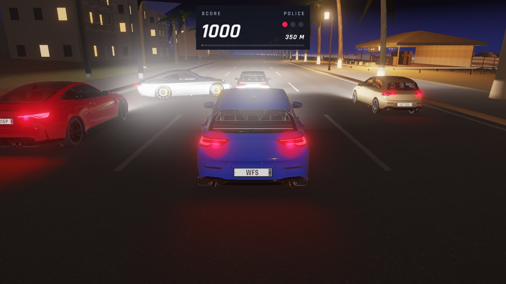 |  |
| `trafic541-pres-01` |  |  |
| `trafic541-pres-02` |  |  |
| `trafic541-pres-03` |  | 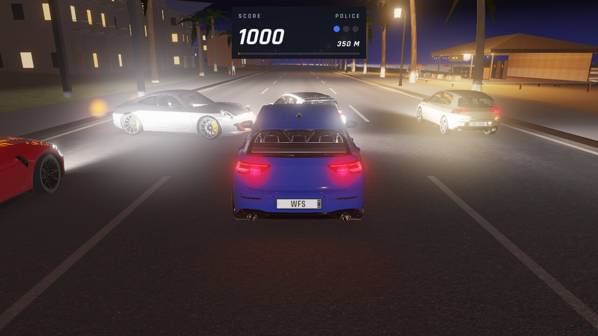 |
| `trafic541-pres-04` | 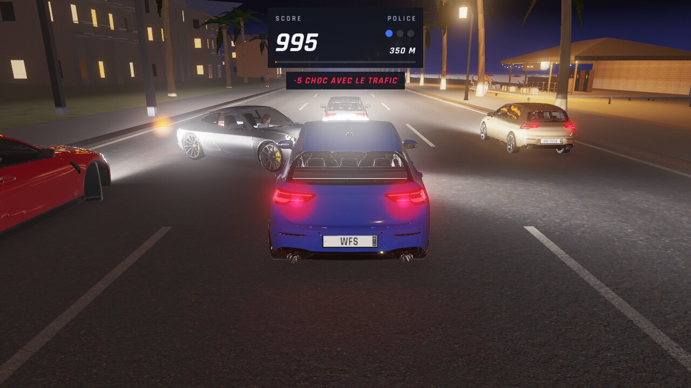 |  |
| `trafic541-pres-05` | 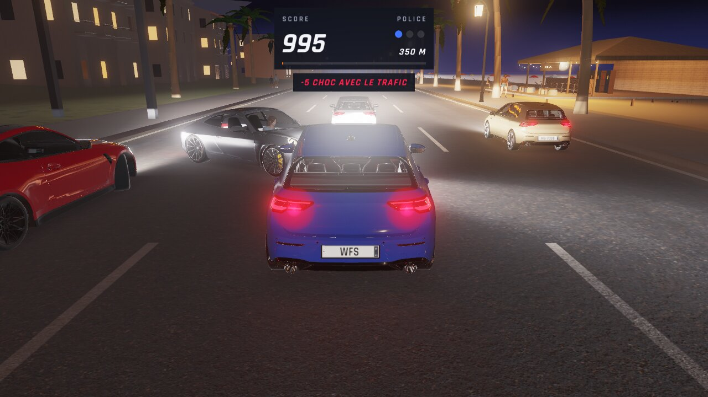 |  |
| `trafic541-pres-06` | 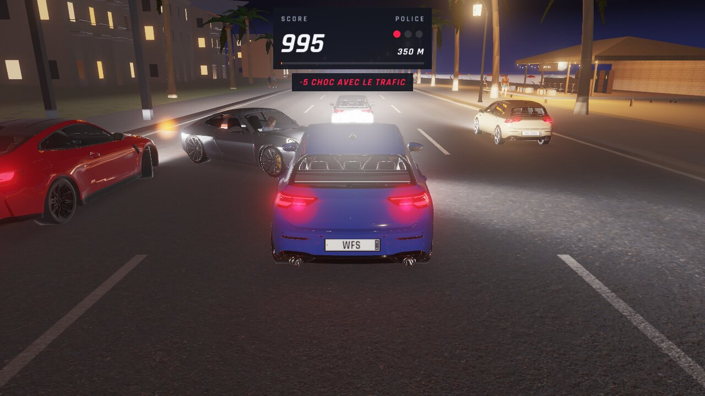 |  |
| `trafic541-pres-07` |  |  |
| `trafic541-suv-00` |  |  |
| `trafic541-suv-01` |  |  |
| `trafic541-suv-02` | 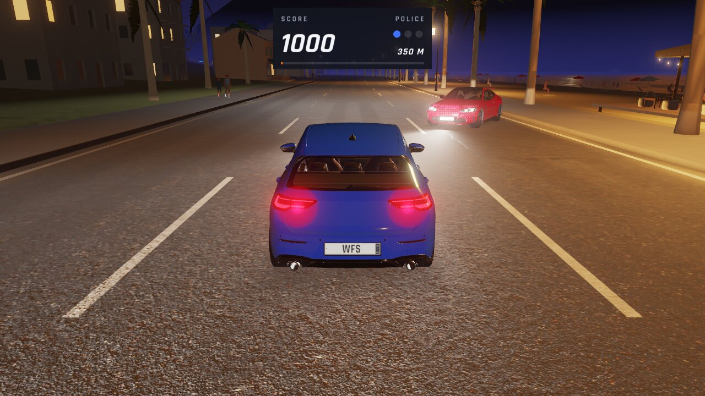 |  |
| `trafic541-suv-03` |  |  |
| `trafic541-suv-04` |  |  |
| `trafic541-suv-05` |  | 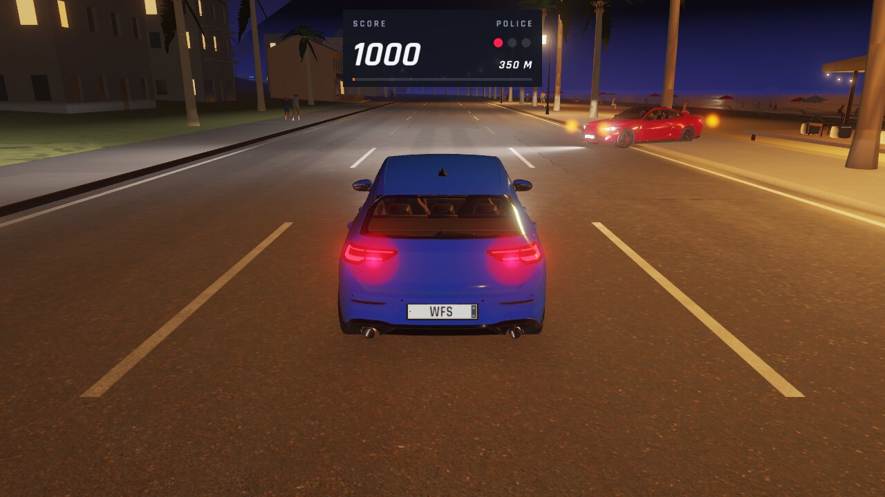 |
| `trafic541-suv-06` | 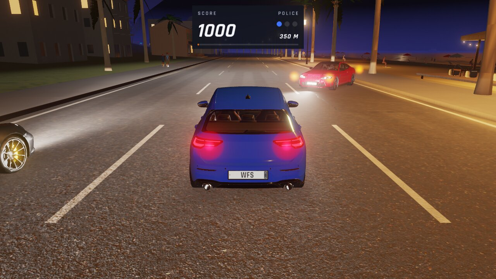 |  |
| `trafic541-suv-07` |  | 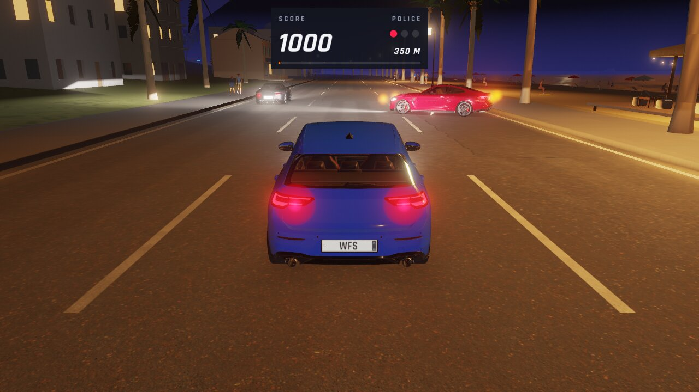 |
| `trafic541-suv-08` |  |  |
| `trafic541-suv-09` |  |  |
| `trafic541-suv-10` |  |  |
| `trafic541-suv-11` | 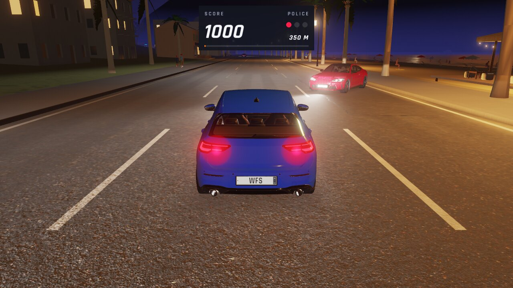 |  |
| `trafic541-suv-12` |  |  |
| `trafic541-suv-13` | 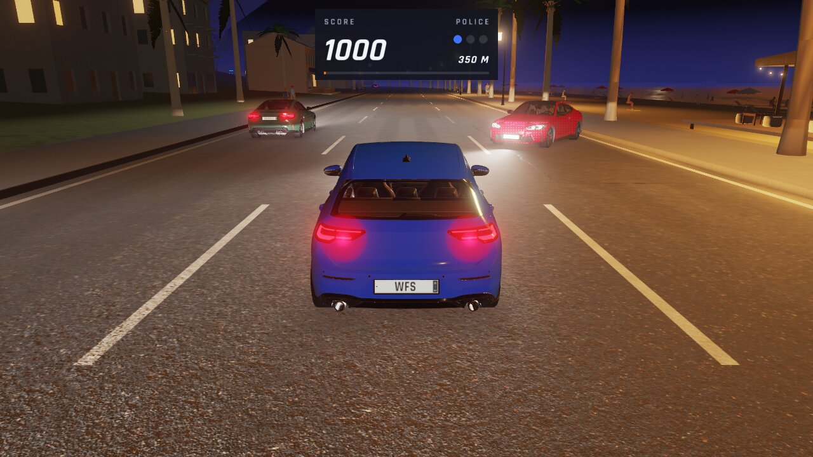 |  |
| `tests-cpu` | — |  |
