# WFS-544 — captures avant / après (tools/qa/captures_pr.sh)

Branche `feature/waforspeed-544` comparée à `origin/main` ; bancs : vitrines ; filtre : `@(records-*|garage-*|course-*|vitrine-p208-0|vitrine-sf90-0)`.

| Capture | Avant (main) | Après (branche) |
|---|---|---|
| `course-sf90` | 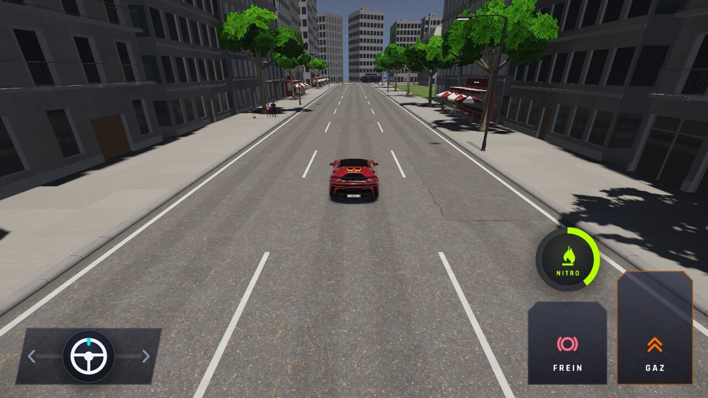 |  |
| `garage-p208` | 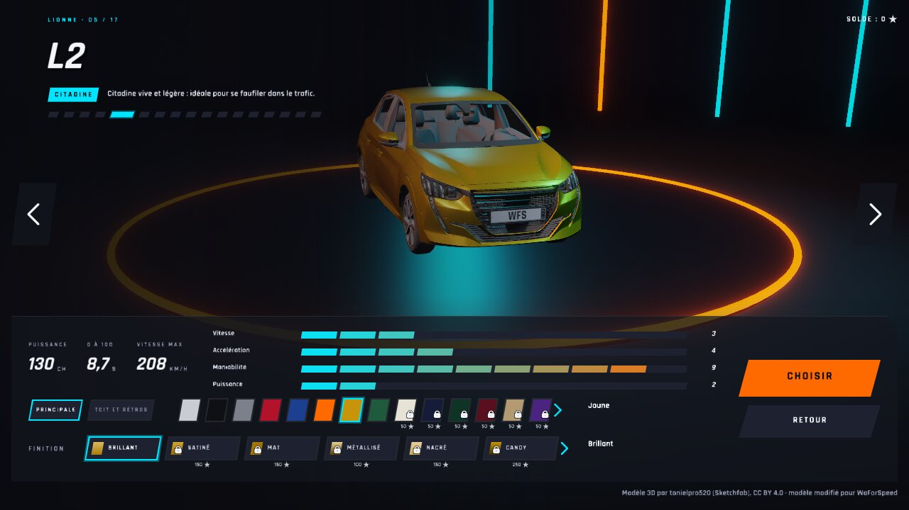 |  |
| `garage-sf90` |  | 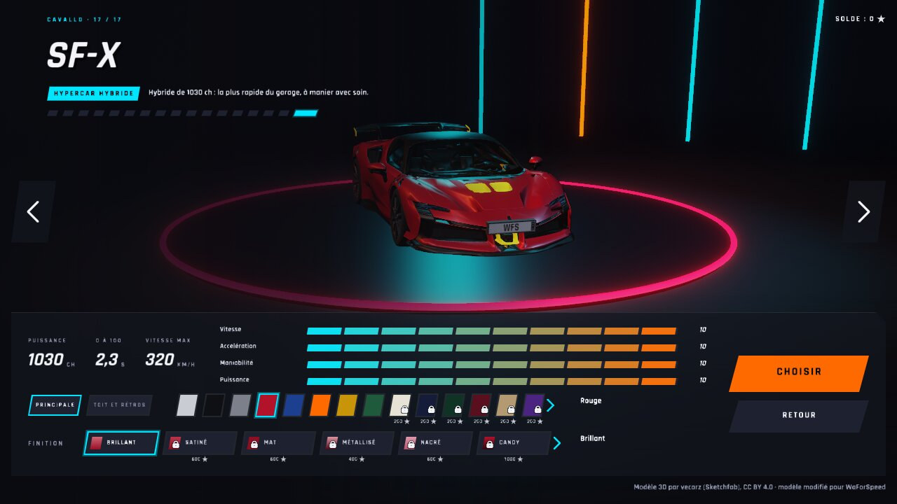 |
| `records-checkpoint` |  | 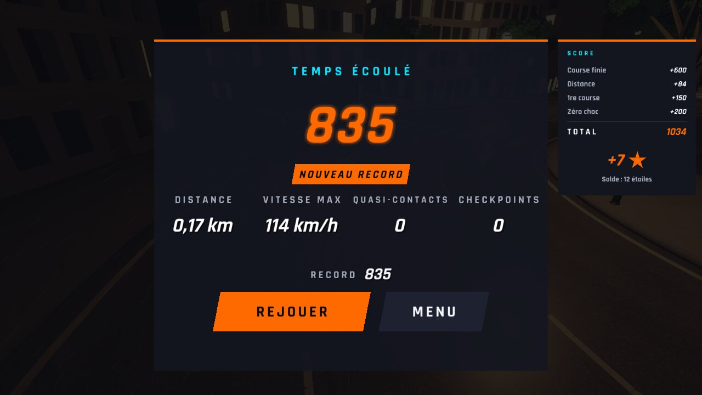 |
| `records-course5` |  | 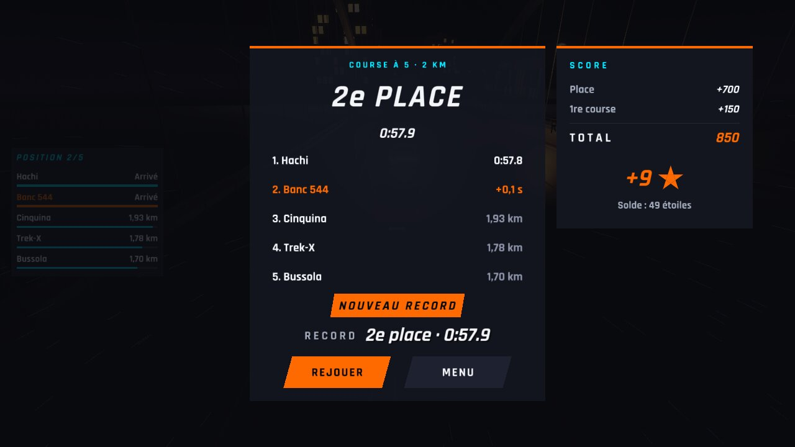 |
| `records-fantome` |  | 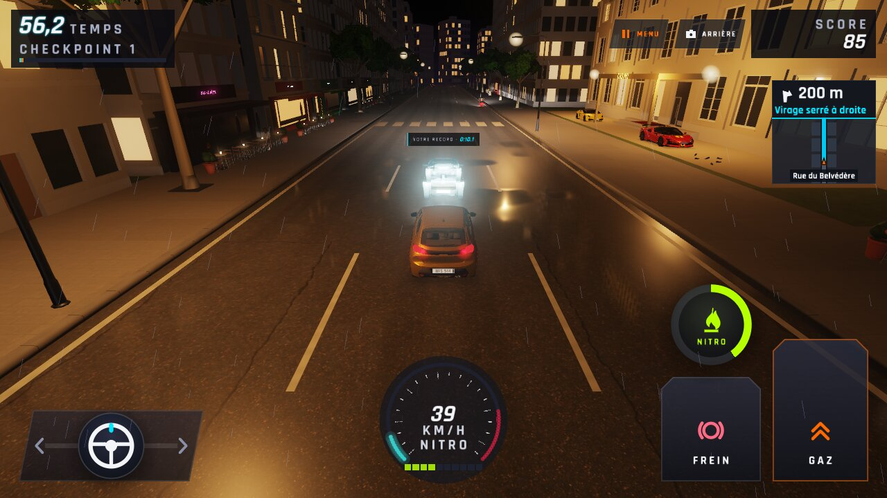 |
| `records-garage` | — | 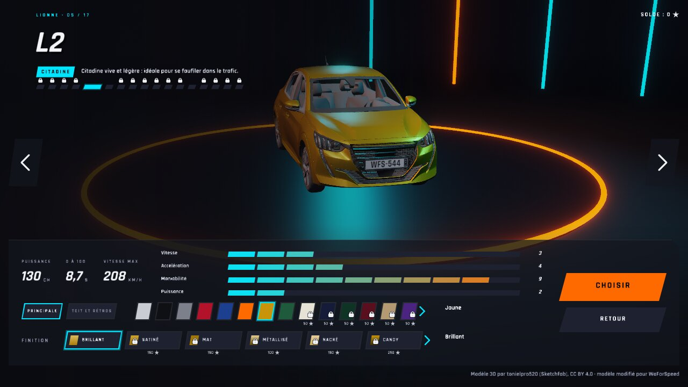 |
| `records-modes` | — | 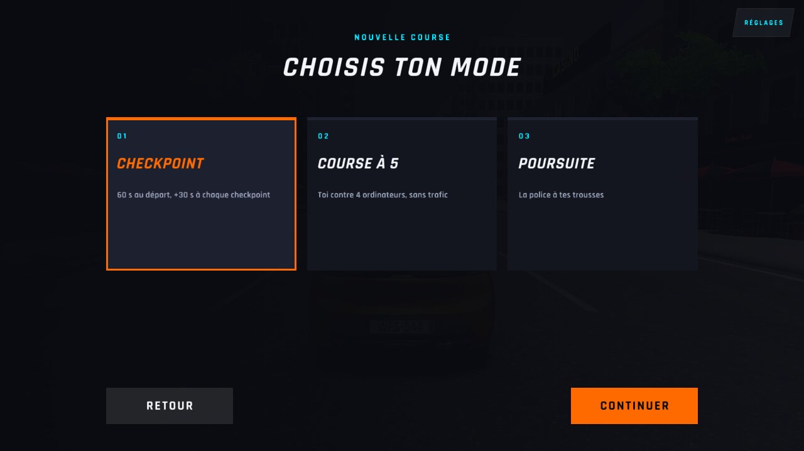 |
| `records-poursuite` | 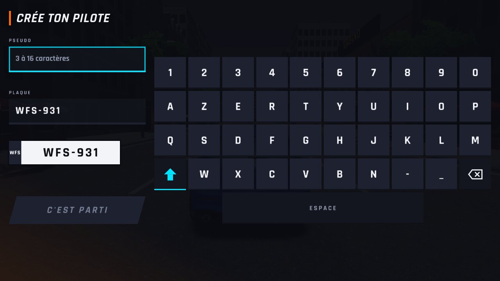 | 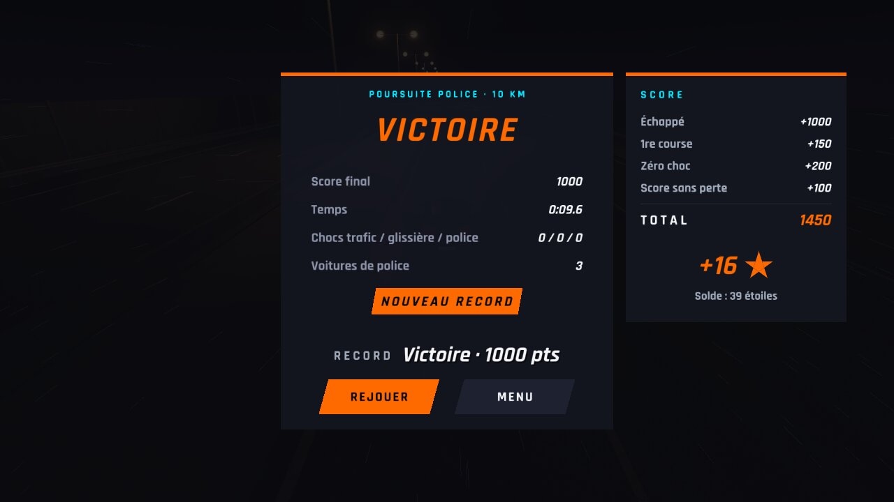 |
| `vitrine-p208-0` |  | 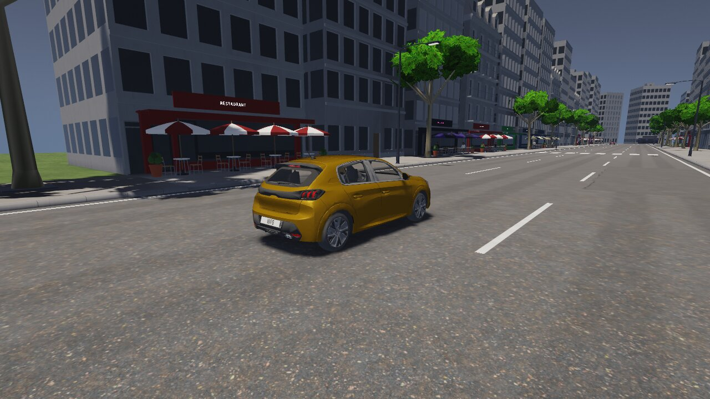 |
| `vitrine-sf90-0` | 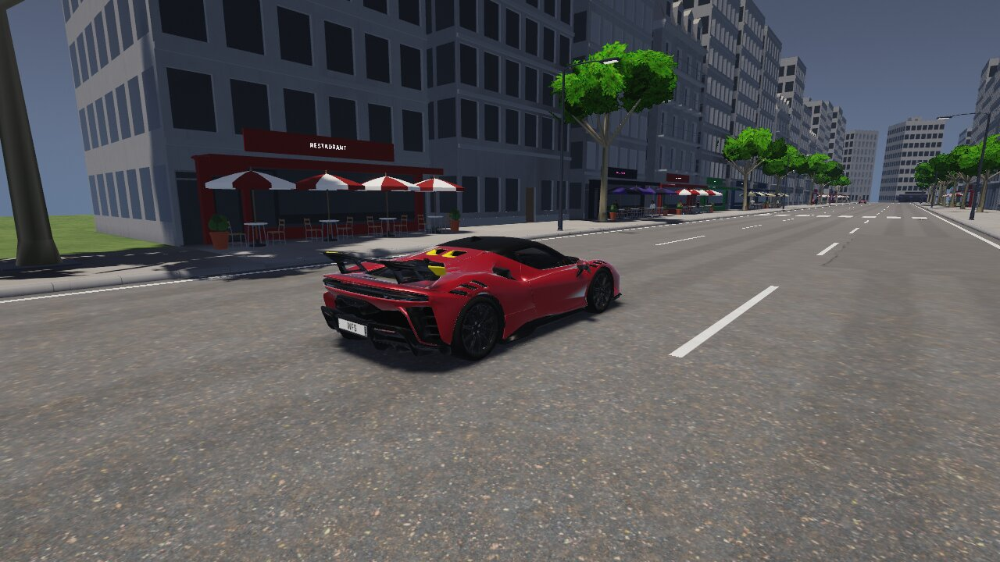 |  |
