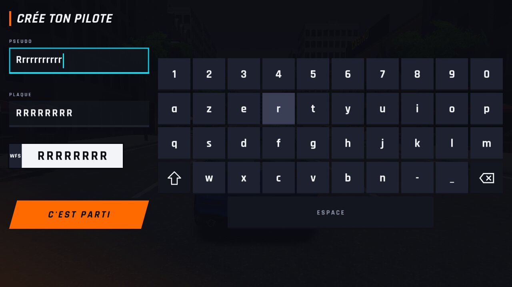
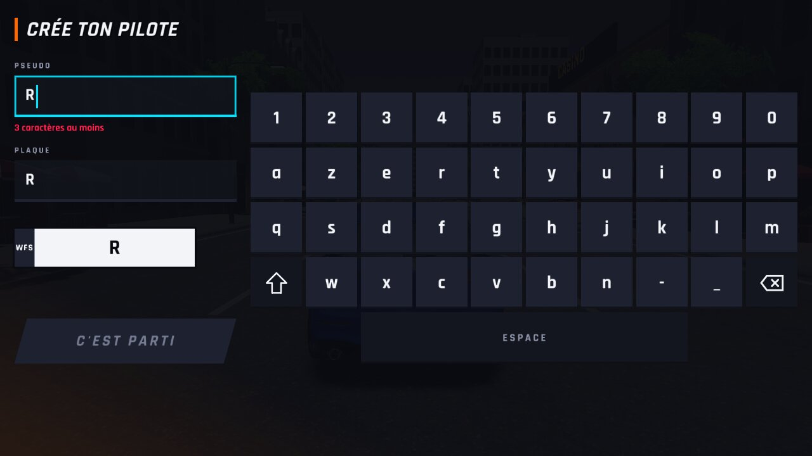
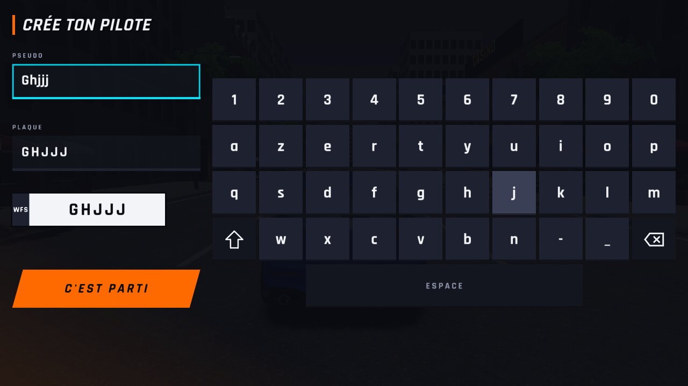
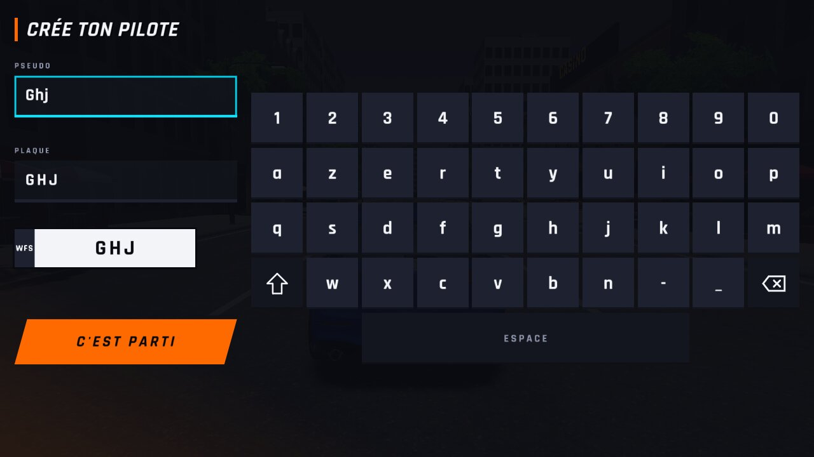
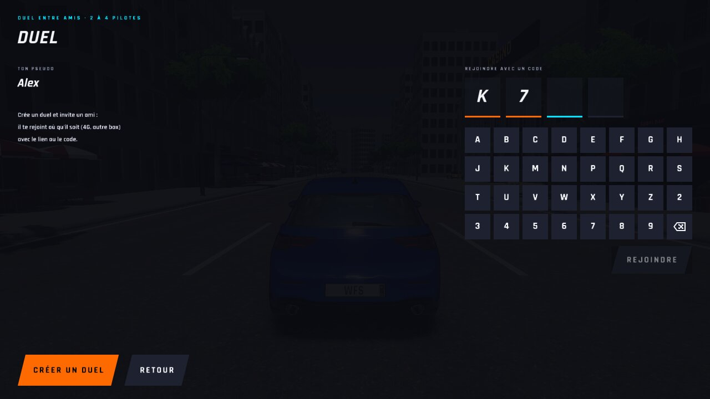
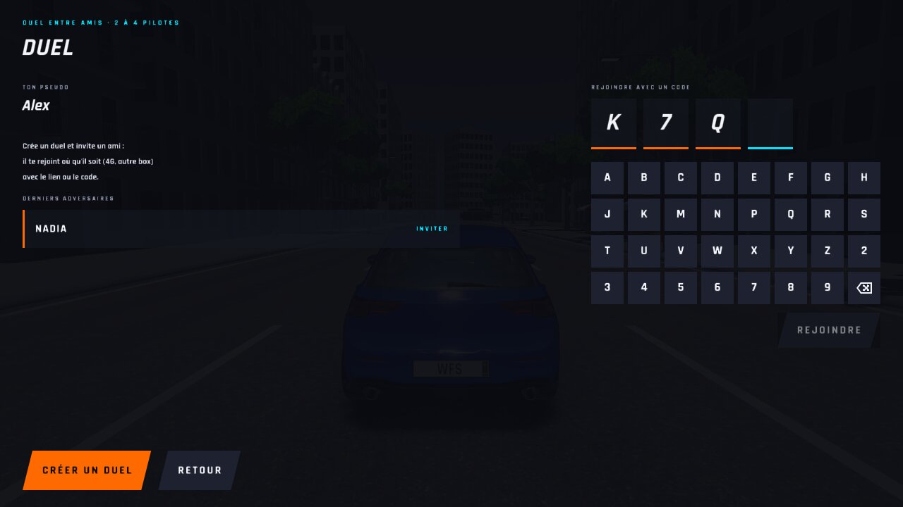
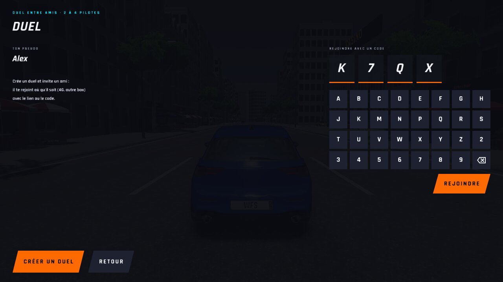
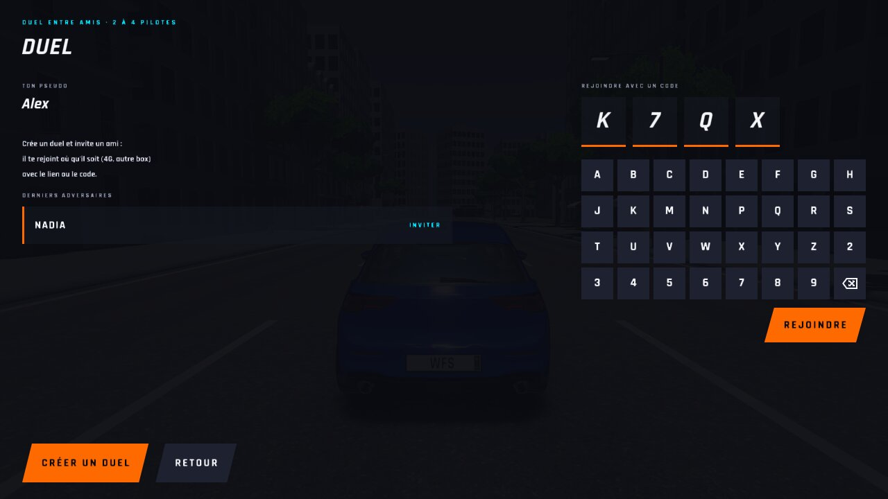
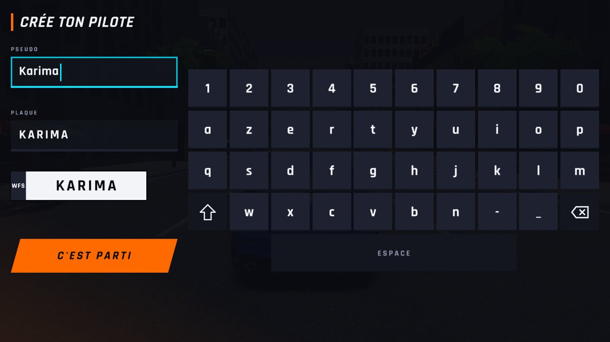
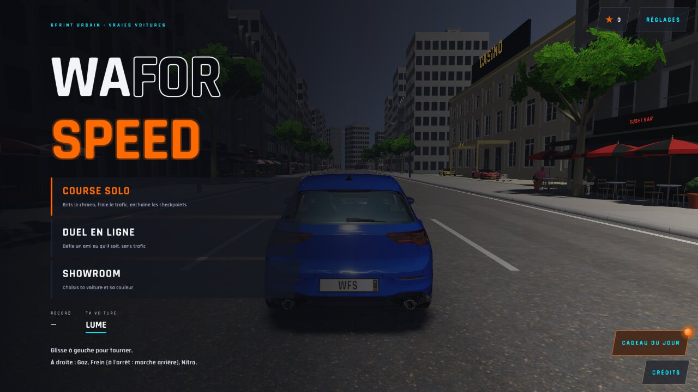

# WFS-545 — captures avant / après

Branche `feature/waforspeed-545` comparée à `origin/main` ; bancs : creation (WFS_LANGUE=fr, 1280x720), menu2:1280x720 (salon). « Avant » = code de `main` + mêmes scénarios de banc que la branche (sans le correctif).

| Capture | Avant (main) | Après (branche) |
|---|---|---|
| `creation-fr-repetition` |  |  |
| `creation-fr-rapide` |  |  |
| `salon-code-efface` |  |  |
| `salon-code-saisi` |  |  |
| `creation-fr-rempli` |  |  |
| `creation-fr-menu` |  |  |
