# WFS-546 — captures avant / après

Banc `WFS_BANC=testeur` (`src/ui/ecrans/reglages_testeur_banc.cpp`) en 1280×720 et 2400×1080 (`tools/qa/captures_pr.sh`, `SANS_AVANT=1` : le banc n'existe pas sur `main`). « Avant » du menu caché : capture `banc-tel-1-menu-cache` du banc `banc-telephone` de `origin/main` (même menu, FR et EN).

| Capture | Avant (main) | Après (branche) |
|---|---|---|
| Menu caché, français, 1280×720 (avant : sans bouton) | 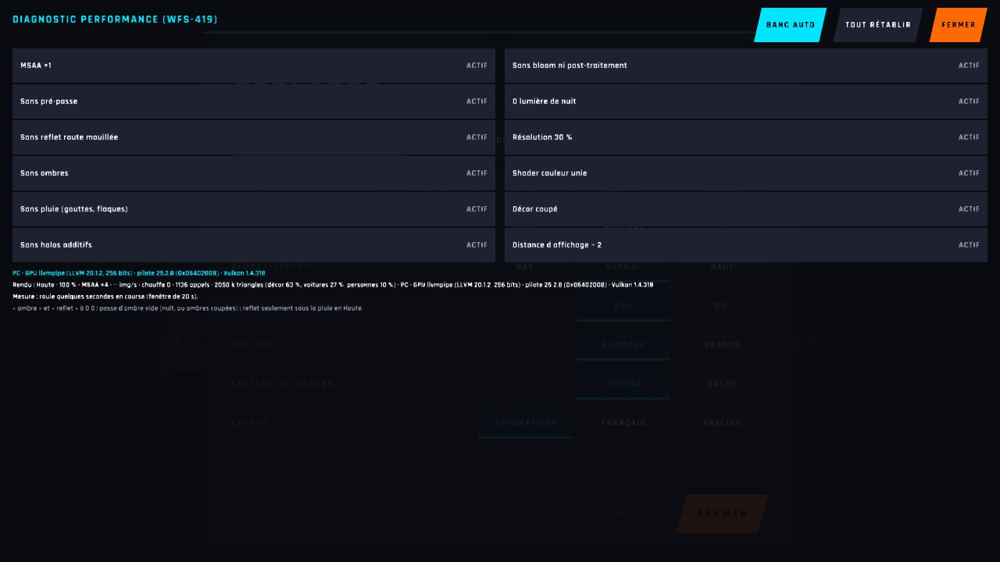 | 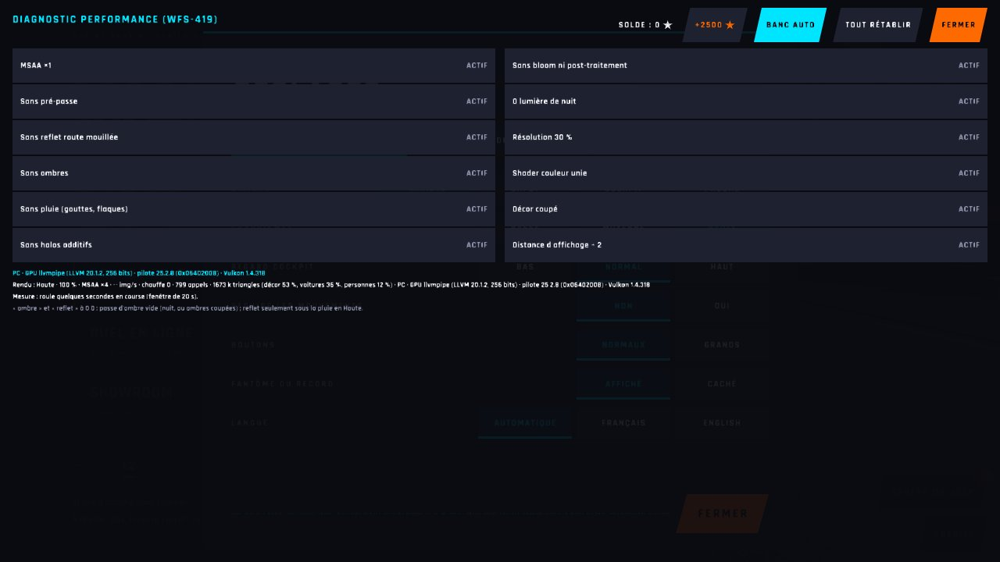 |
| Menu caché, français, téléphone 2400×1080 : « +2500 ★ » à gauche de « Banc auto », solde 0 ★ | — (pas de bouton ni de banc sur main) | 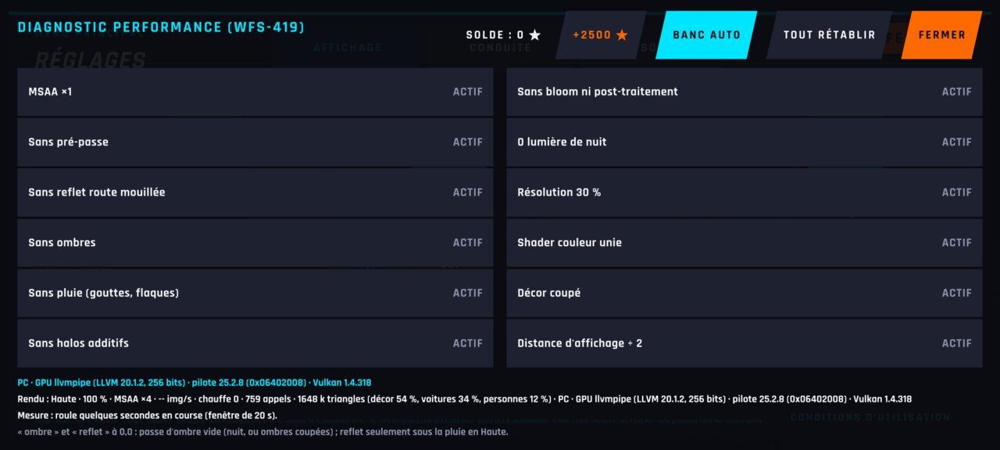 |
| Après 2 appuis (posé + 2 mouvements + levé, chacun) : « Solde : 5 000 ★ », bouton éclairé (téléphone) | — (pas de bouton ni de banc sur main) | 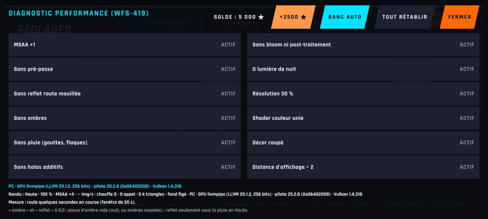 |
| Après 2 appuis, 1280×720 | — (pas de bouton ni de banc sur main) | 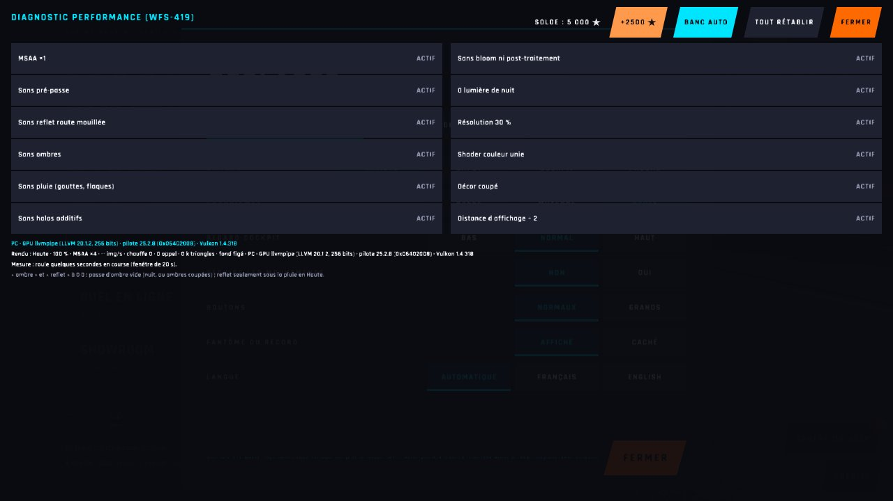 |
| Menu principal : compteur d'étoiles à 5 000 (téléphone) | — (pas de bouton ni de banc sur main) | 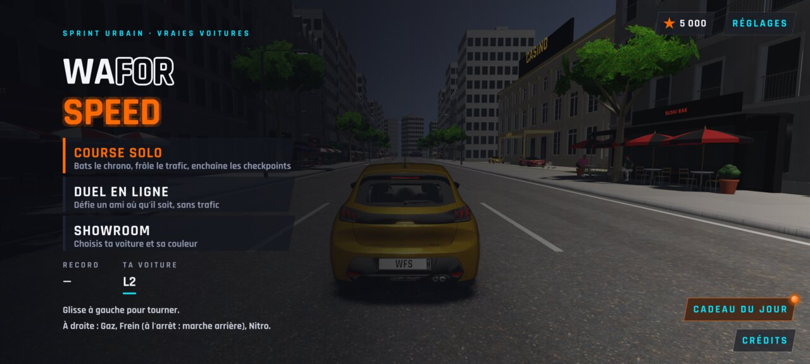 |
| Menu caché en anglais, 1280×720 (avant : sans bouton) : « Balance: 5,000 ★ » | 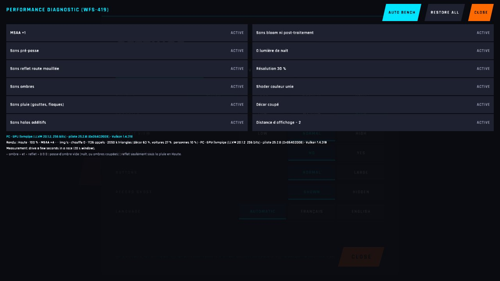 | 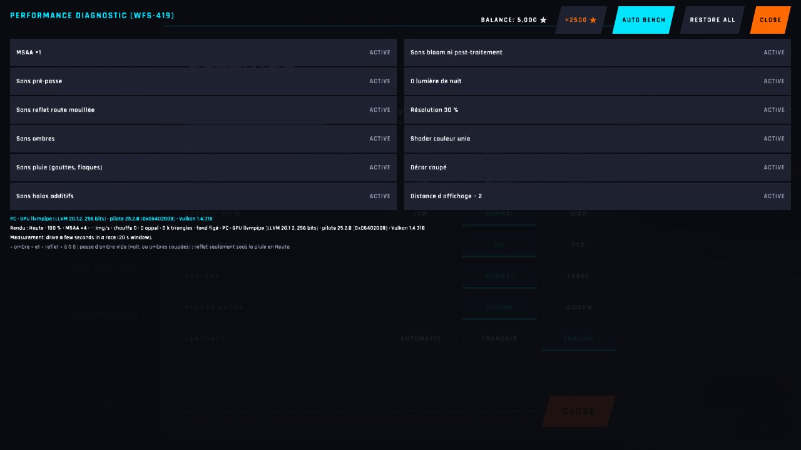 |
| Menu caché en anglais, téléphone | — (pas de bouton ni de banc sur main) | 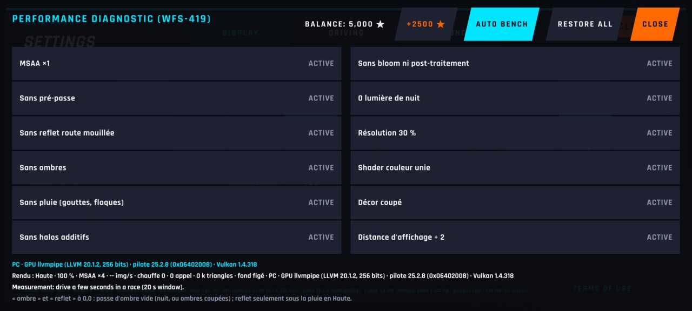 |
| Garage de la 208 : Chromé (400 ★) en aperçu, solde 5 000 ★ (téléphone) | — (pas de bouton ni de banc sur main) |  |
| Chromé acheté : cadenas tombé, solde 4 600 ★ (téléphone) | — (pas de bouton ni de banc sur main) | 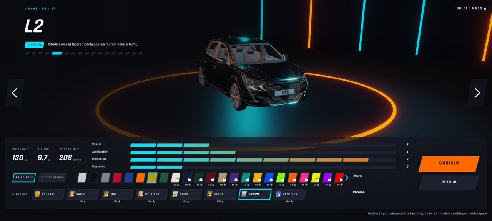 |
| Chromé acheté, 1280×720 | — (pas de bouton ni de banc sur main) | 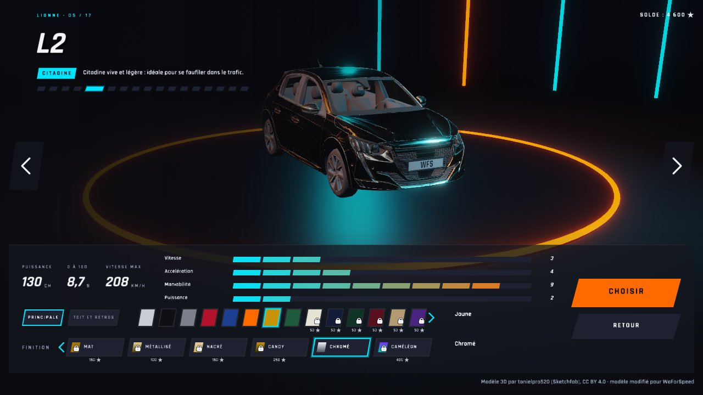 |
