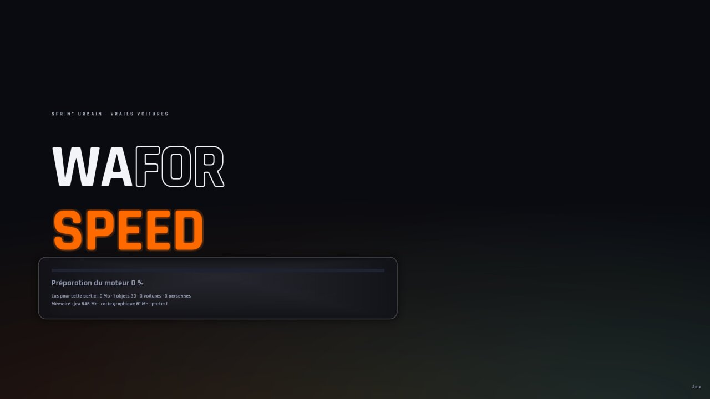
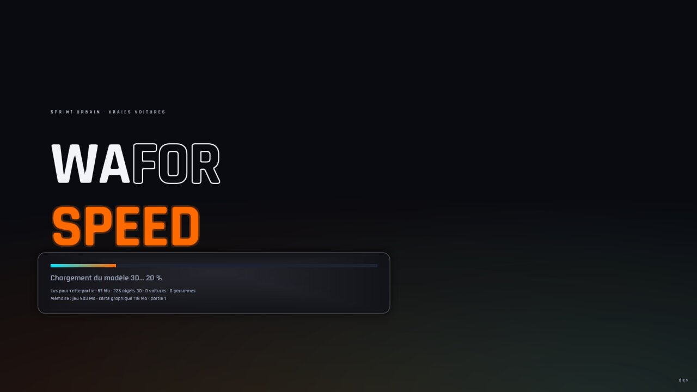
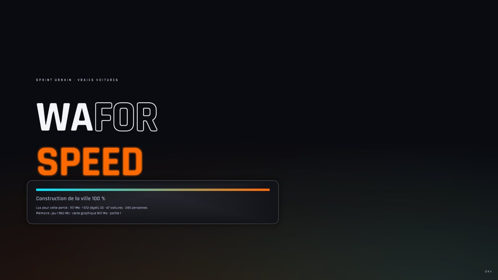
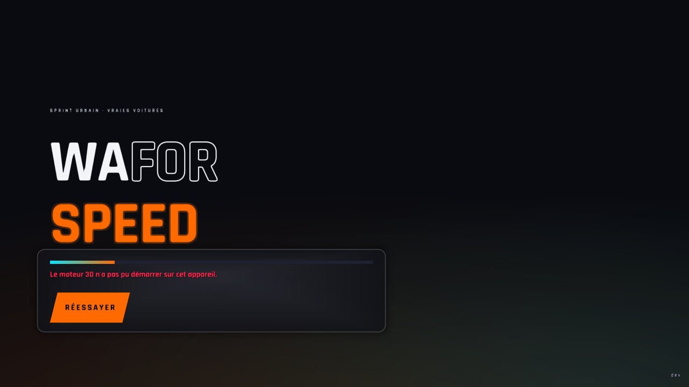
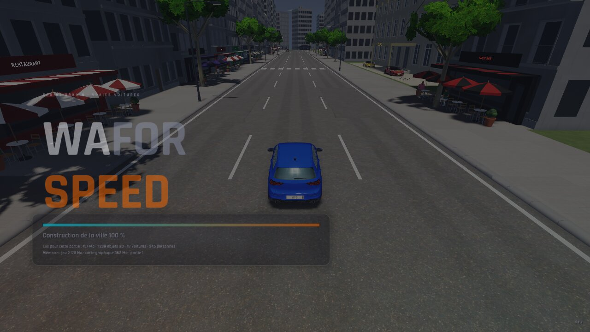

# WFS-555 — captures avant / après (tools/qa/captures_pr.sh)

Branche `feature/waforspeed-555` comparée à `origin/main` ; bancs : chargement ; filtre : `*`.

Captures « avant » : `origin/main` = `42bdd896d14fd07b6b3fb6b165aa51c4f2d0c277` ; cache : 0 banc(s) relu(s), 1 banc(s) rejoué(s) ; main compilé : oui.

| Capture | Avant (main) | Après (branche) |
|---|---|---|
| `chargement-0` |  |  |
| `chargement-1` |  |  |
| `chargement-2` |  |  |
| `chargement-erreur` |  |  |
| `chargement-fondu` |  |  |
