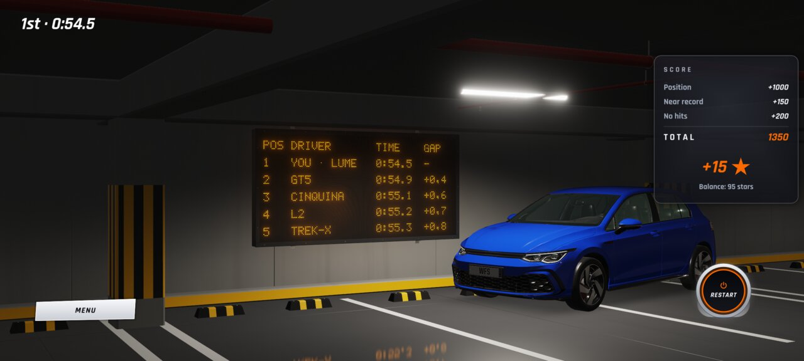
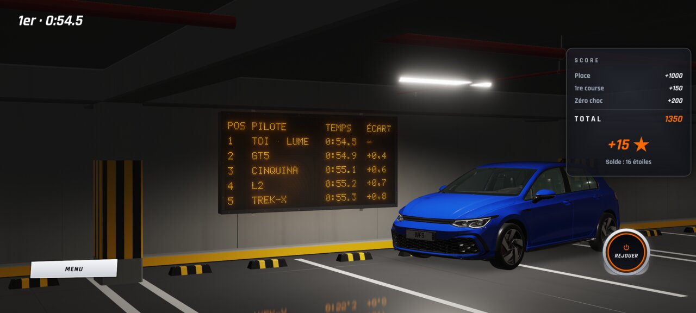
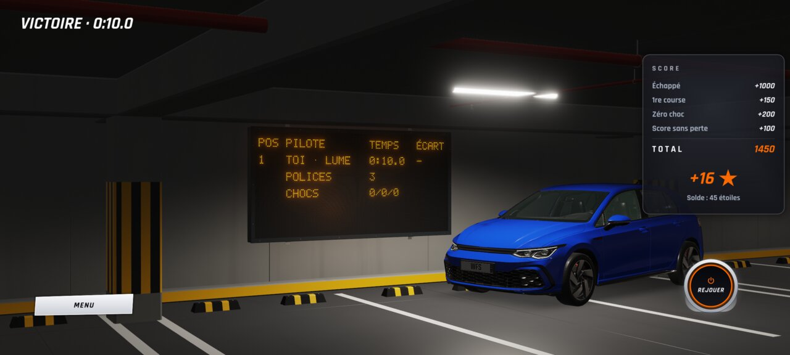

# WFS-561 — captures avant / après (tools/qa/captures_pr.sh)

Branche `feature/waforspeed-561` comparée à `origin/main` ; bancs : resultats3d-modes:2400x1080 ; filtre : `*`.

Captures « avant » : aucune (SANS_AVANT=1).

| Capture | Avant (main) | Après (branche) |
|---|---|---|
| `resultats3d-modes-en-course5-1er-2400x1080` | — |  |
| `resultats3d-modes-en-duel-2400x1080` | — |  |
| `resultats3d-modes-en-poursuite-echappe-2400x1080` | — |  |
| `resultats3d-modes-fr-course5-1er-2400x1080` | — |  |
| `resultats3d-modes-fr-course5-3e-2400x1080` | — |  |
| `resultats3d-modes-fr-duel-2400x1080` | — |  |
| `resultats3d-modes-fr-poursuite-arrete-2400x1080` | — |  |
| `resultats3d-modes-fr-poursuite-echappe-2400x1080` | — |  |
| `resultats3d-modes-fr-repli-course5-2400x1080` | — |  |
