# WFS-567 — captures avant / après (tools/qa/captures_pr.sh)

Branche `feature/waforspeed-567` comparée à `origin/main` ; bancs : messages:1280x720 ; filtre : `*`.

Captures « avant » : `origin/main` = `63293244c3af75c993054d1213233ab698ed3de0` ; cache : 1 banc(s) relu(s), 0 banc(s) rejoué(s) ; main compilé : non.

| Capture | Avant (main) | Après (branche) |
|---|---|---|
| `messages-checkpoint-depart` | 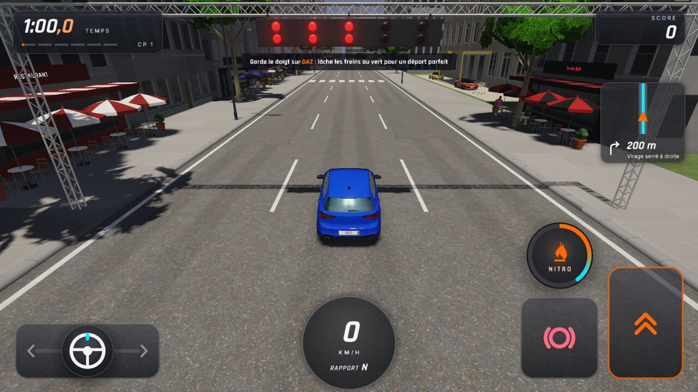 | 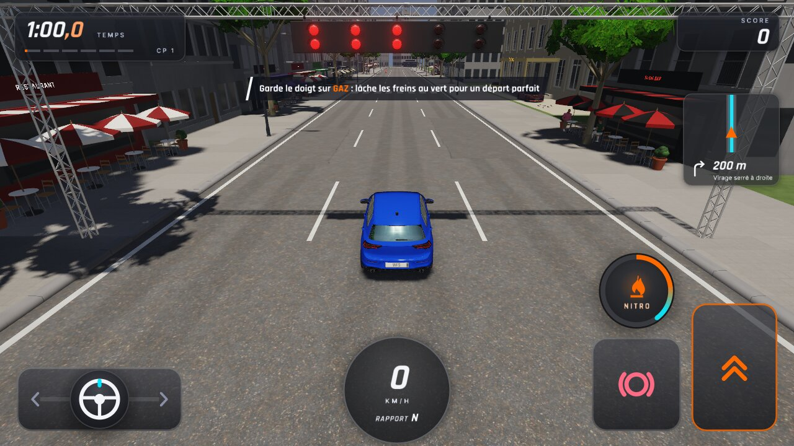 |
| `messages-checkpoint-jour` | 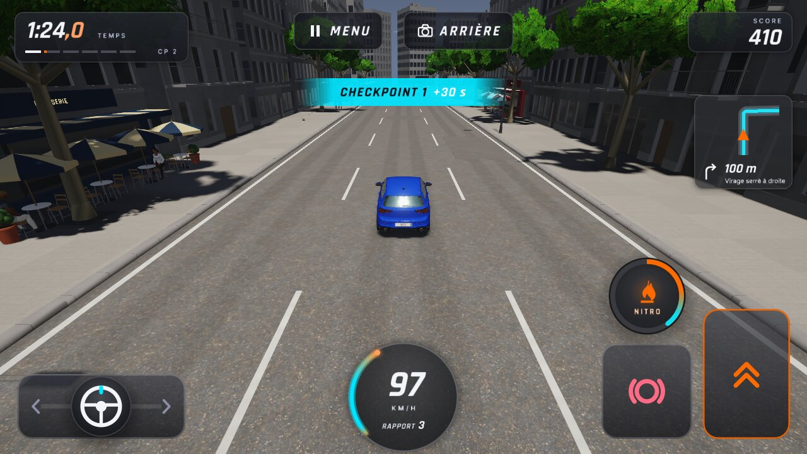 | 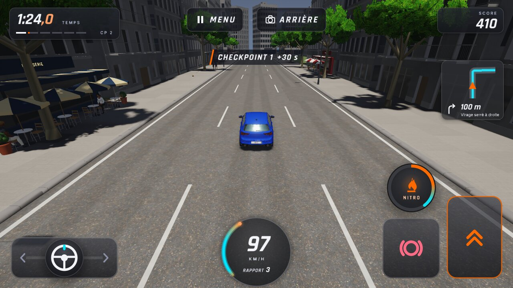 |
| `messages-poursuite-depart` | 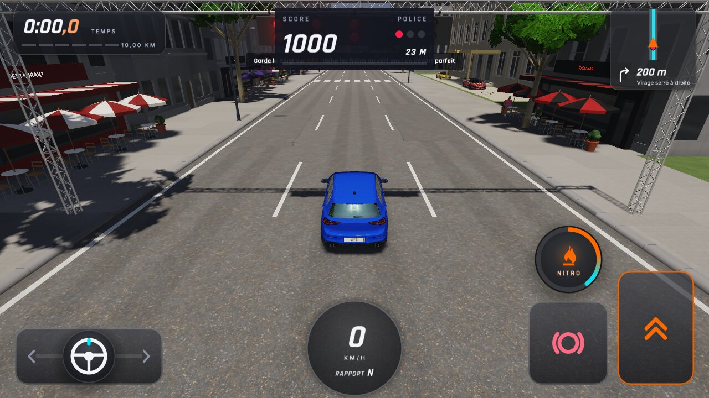 | 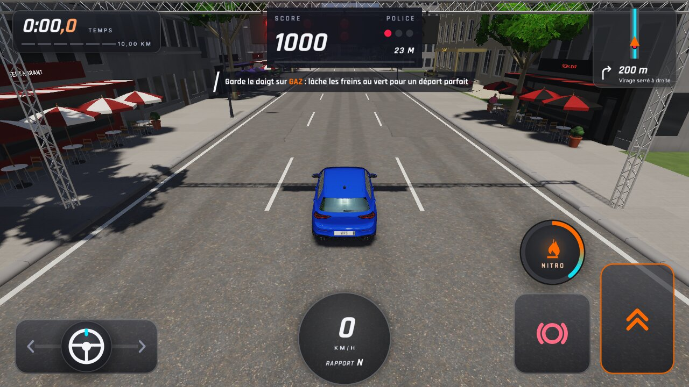 |
| `messages-poursuite-renfort` | 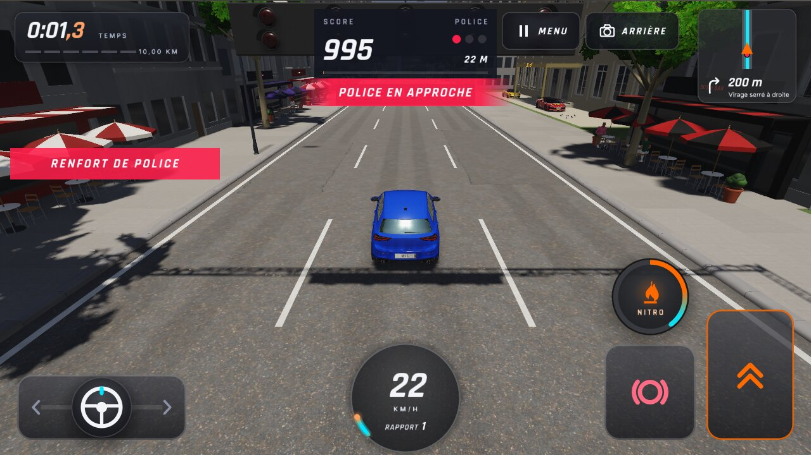 | 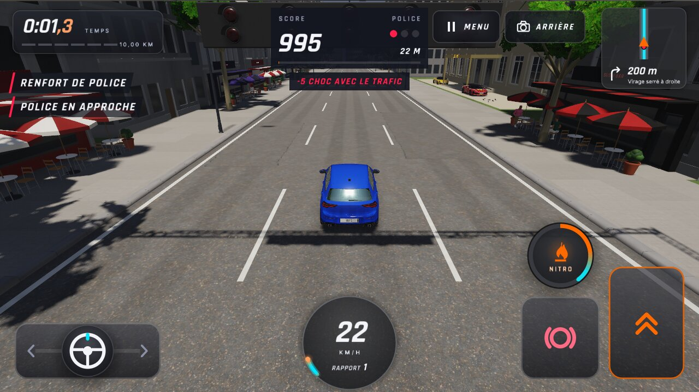 |
| `messages-poursuite-surprise-jour` | 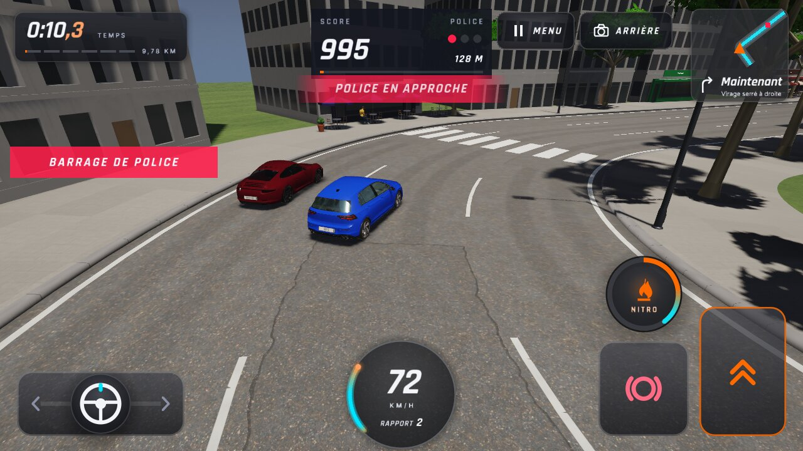 | 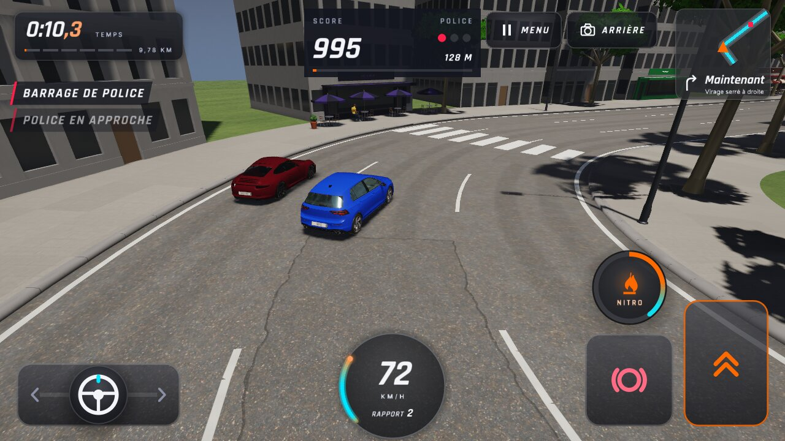 |
| `messages-poursuite-surprise-nuit` | 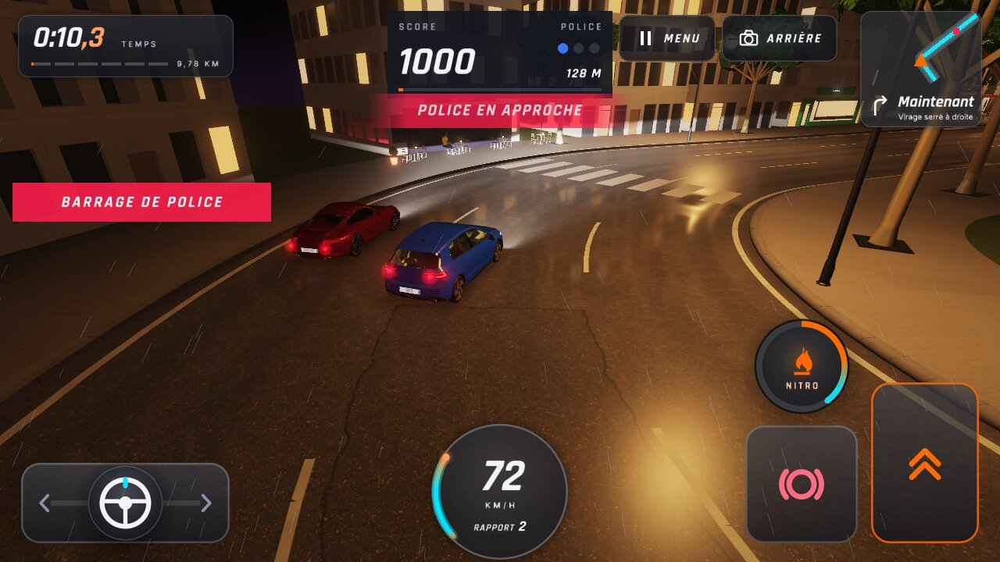 | 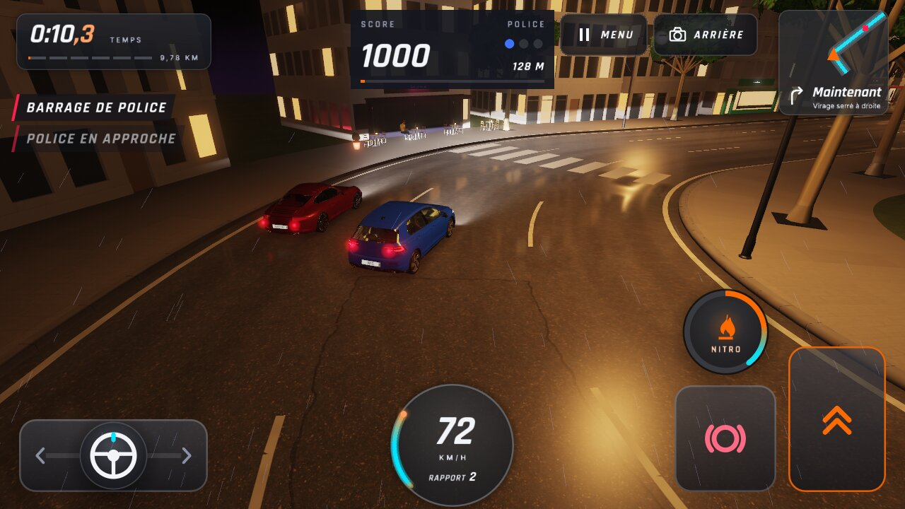 |
| `messages-serie-jour` | 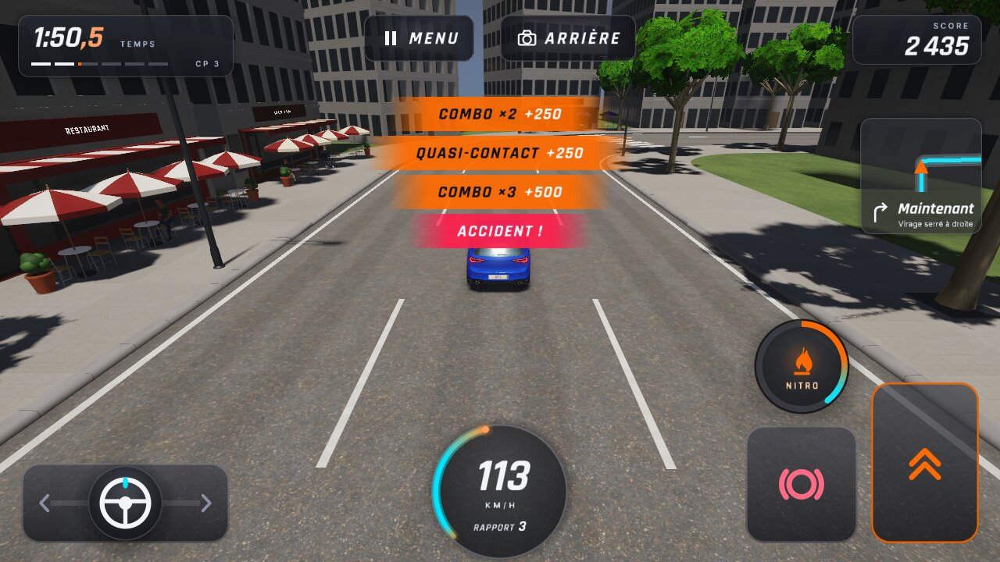 | 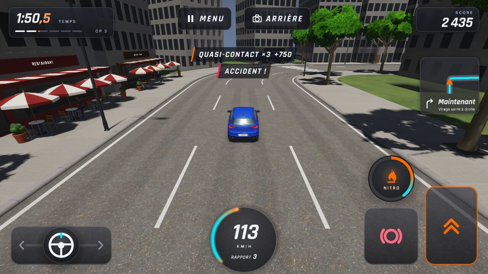 |
| `messages-serie-nuit` | 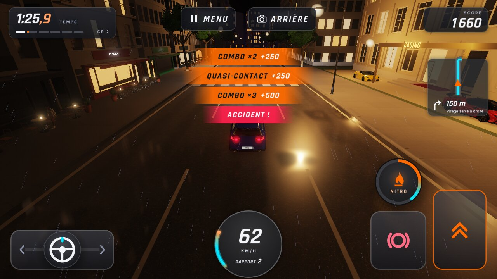 | 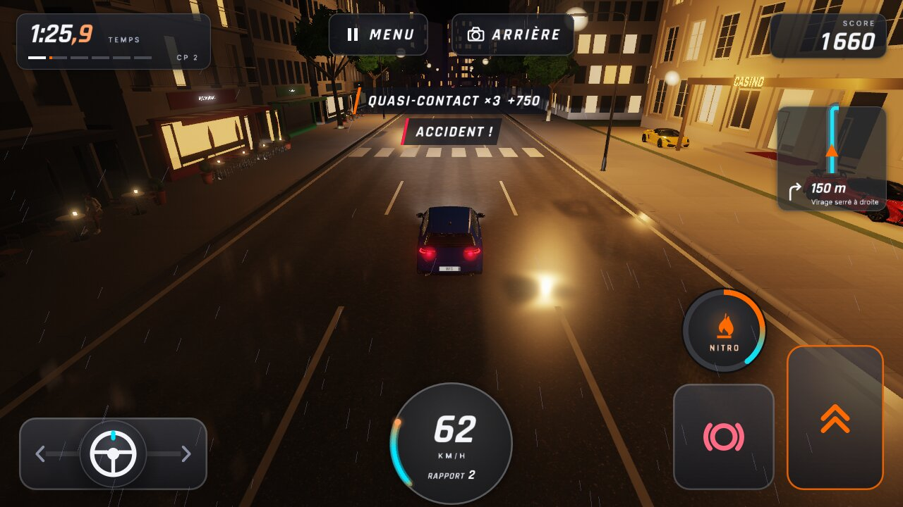 |
