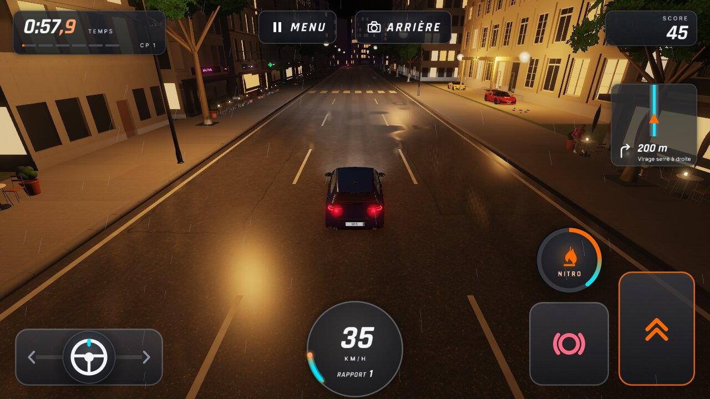
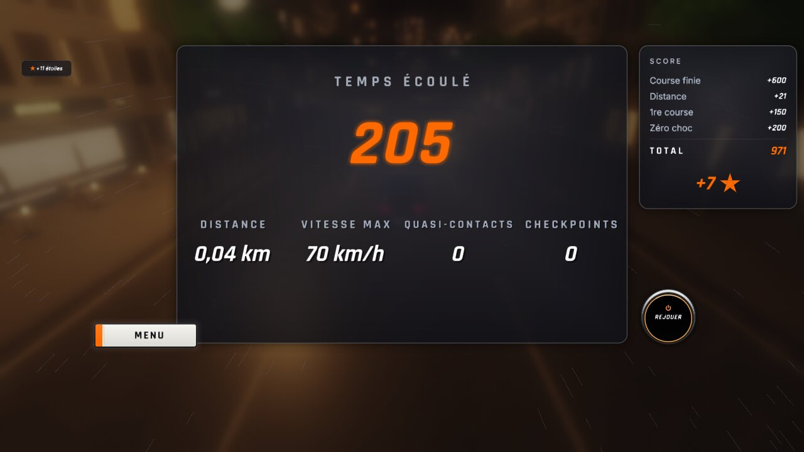
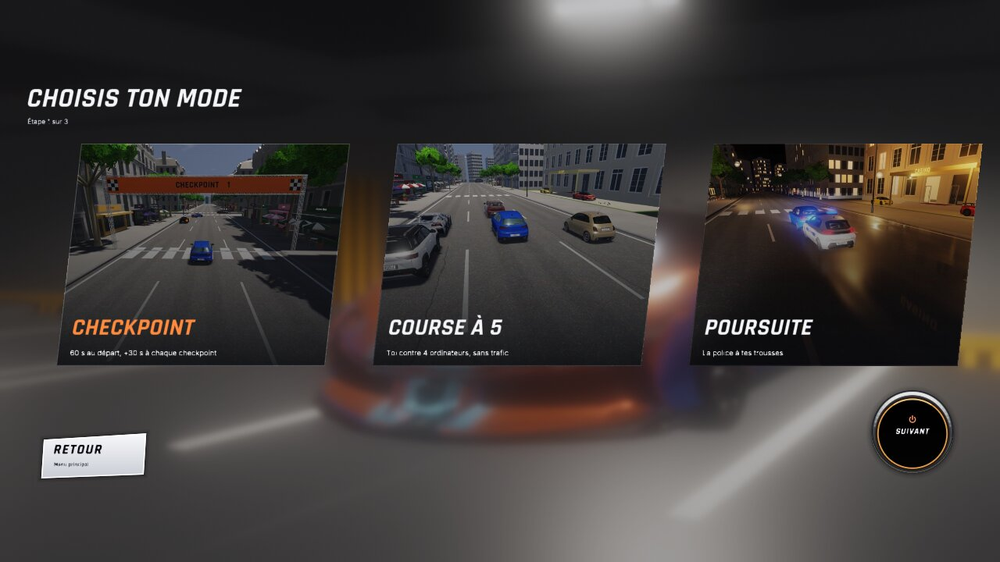
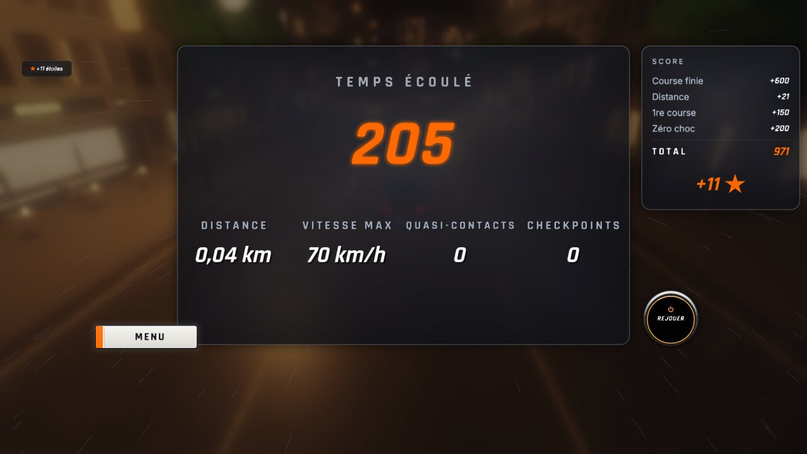
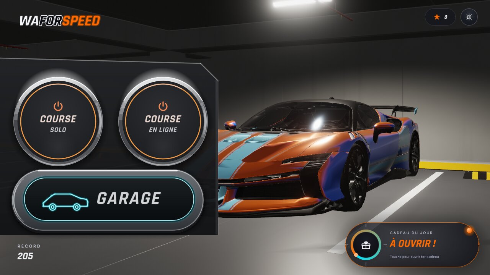
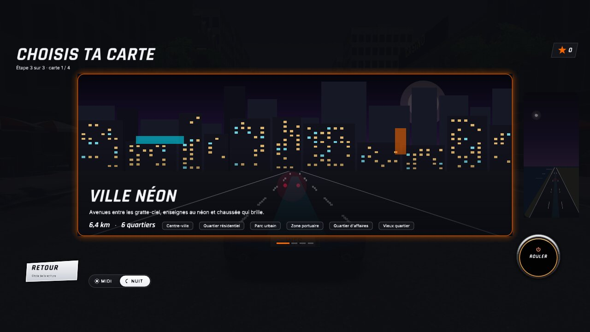
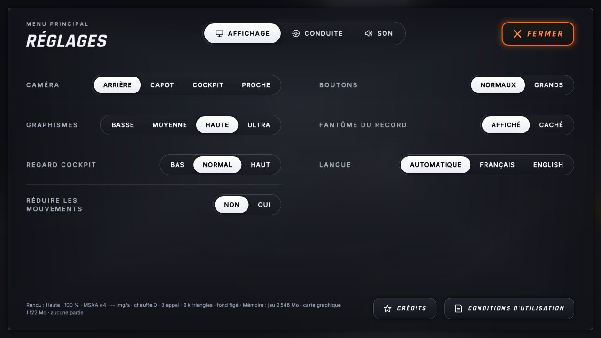
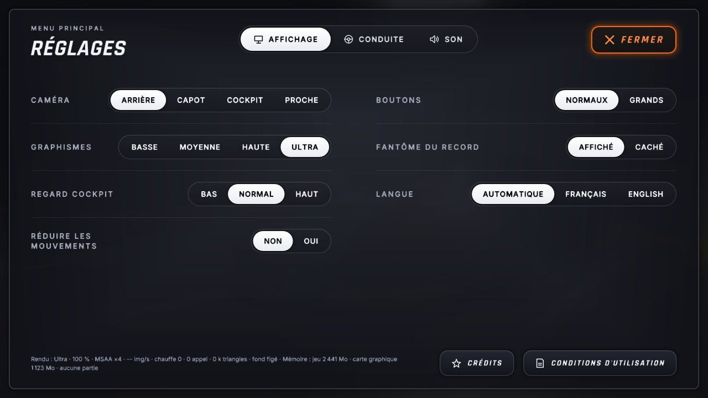

# WFS-589 — captures avant / après (tools/qa/captures_pr.sh)

Branche `feature/waforspeed-589` comparée à `origin/main` ; bancs : parcours chauffe ; filtre : `parcours-*`.

Captures « avant » : `origin/main` = `f9a63d67bd92d1d11da204acda40bcb09ded2d7e` ; cache : 0 banc(s) relu(s), 2 banc(s) rejoué(s) ; main compilé : oui.

| Capture | Avant (main) | Après (branche) |
|---|---|---|
| `parcours-course` |  |  |
| `parcours-fin` |  |  |
| `parcours-mode-3-cartes` |  |  |
| `parcours-mode` |  |  |
| `parcours-retour-menu` |  |  |
| `parcours-terrain` |  |  |
| `reglages-qualite-ultra` |  |  |
