# WFS-597 — captures avant / après (tools/qa/captures_pr.sh)

Branche `feature/waforspeed-597` comparée à `origin/main` ; bancs : chargement:2400x1080 ; filtre : `*`.

Captures « avant » : `origin/main` = `f9a63d67bd92d1d11da204acda40bcb09ded2d7e` ; cache : 0 banc(s) relu(s), 1 banc(s) rejoué(s) ; main compilé : oui.

| Capture | Avant (main) | Après (branche) |
|---|---|---|
| `chargement-0` | 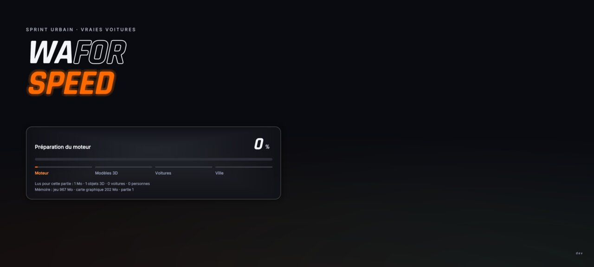 |  |
| `chargement-1` | 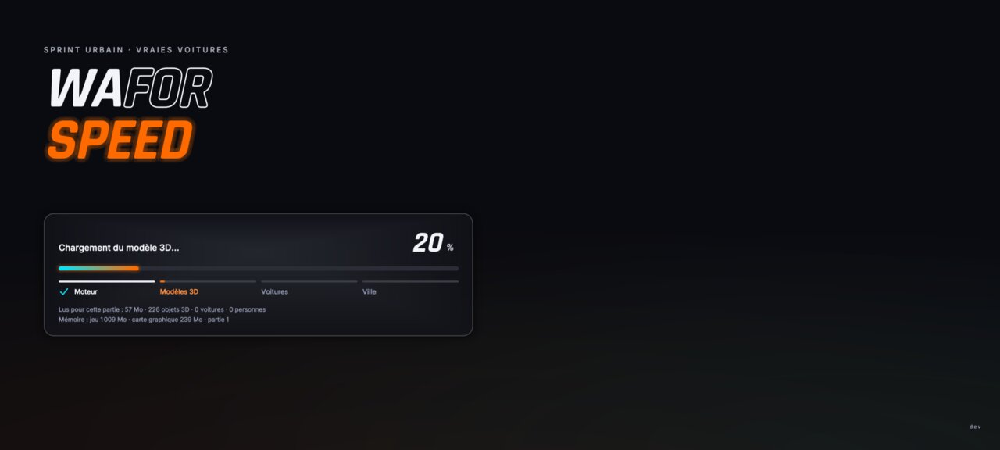 | 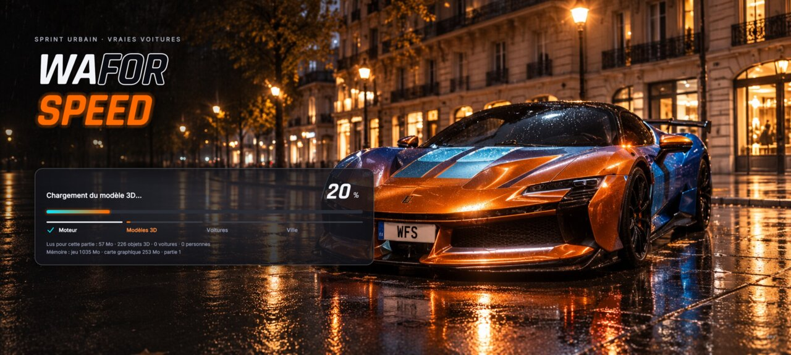 |
| `chargement-2` | 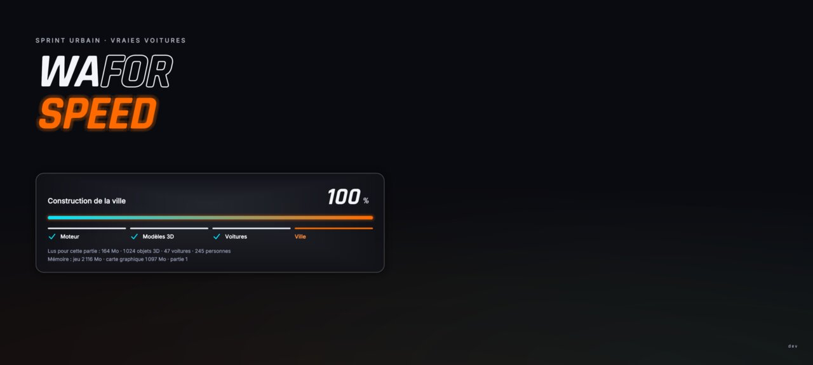 | 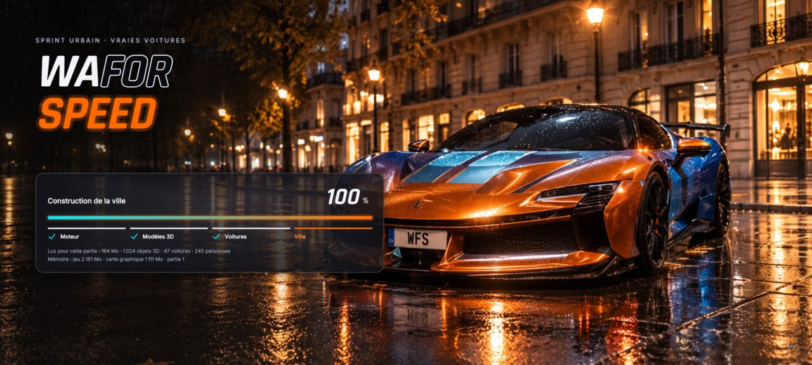 |
| `chargement-erreur` | 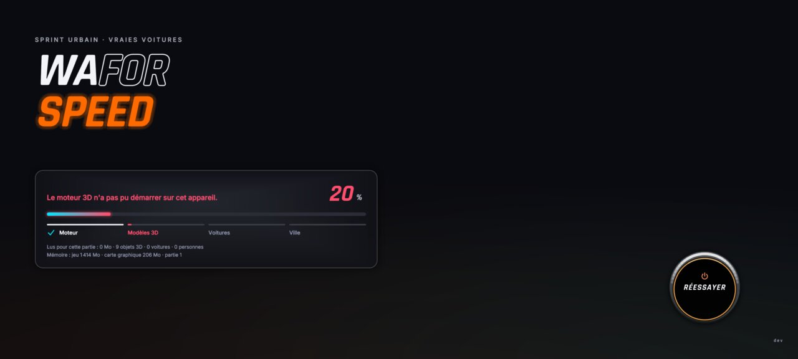 |  |
| `chargement-fondu` | 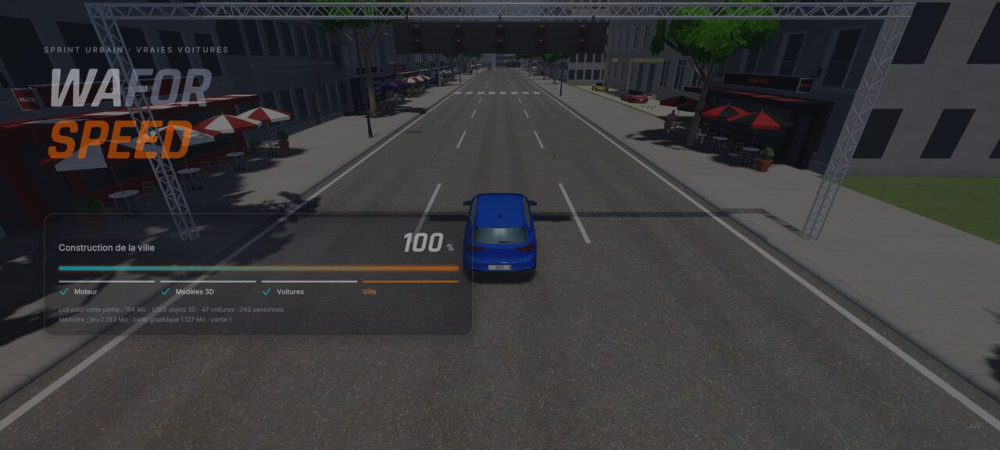 | 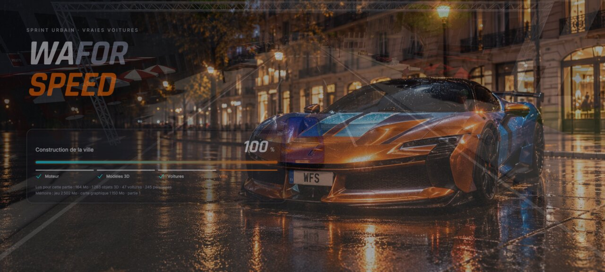 |
| `chargement-route` | 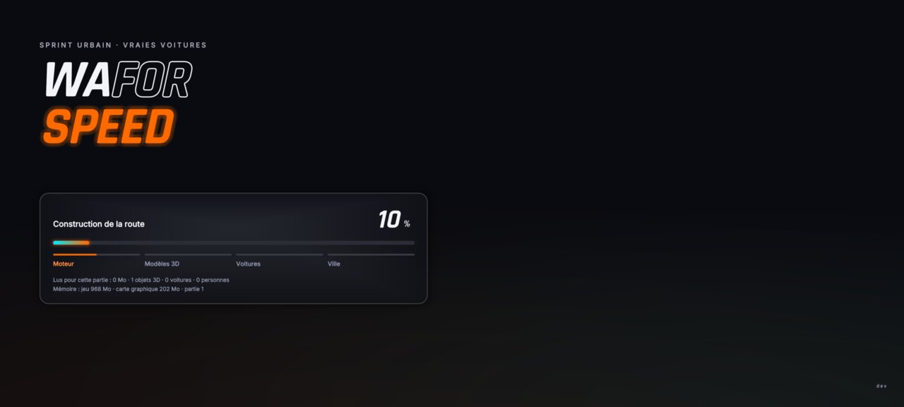 | 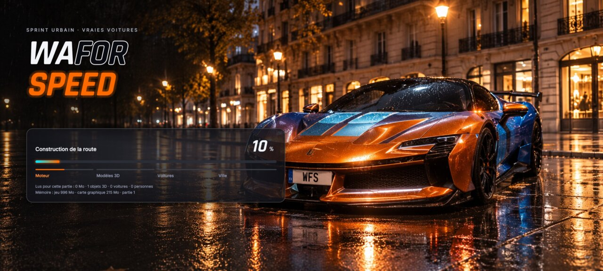 |
| `chargement-ville` | 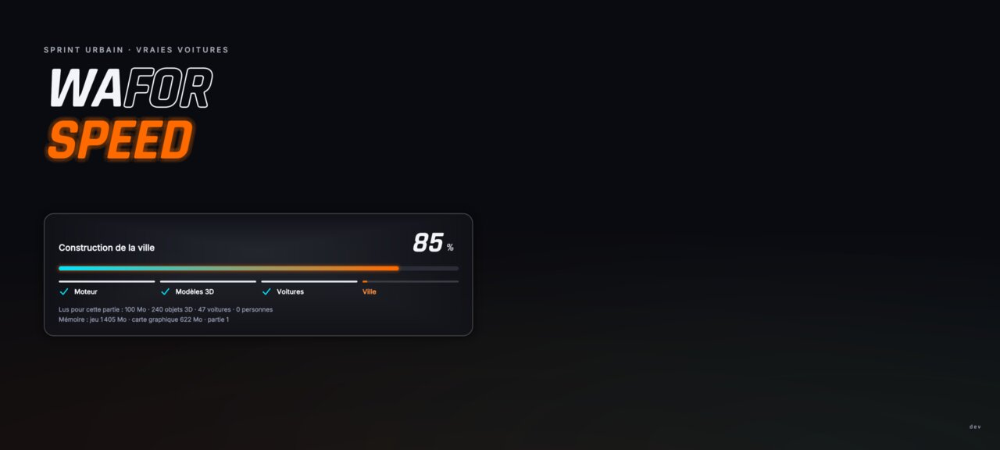 | 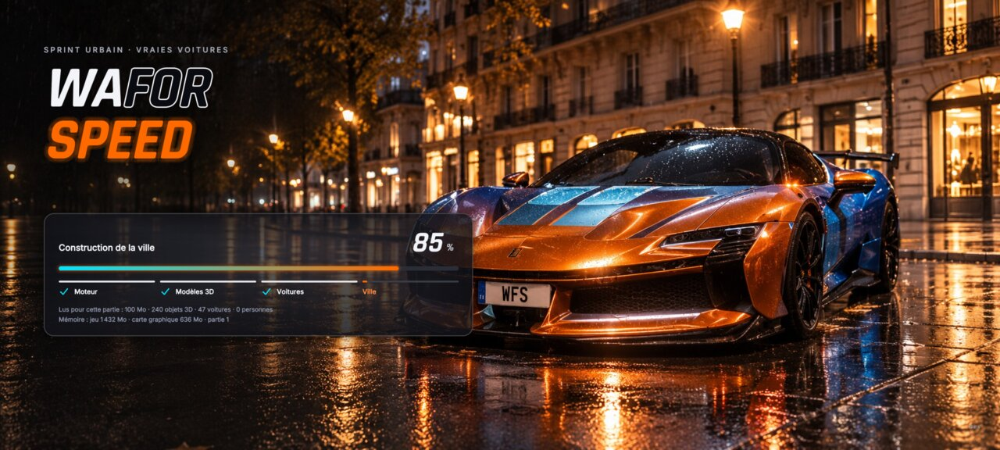 |
| `chargement-voitures` | 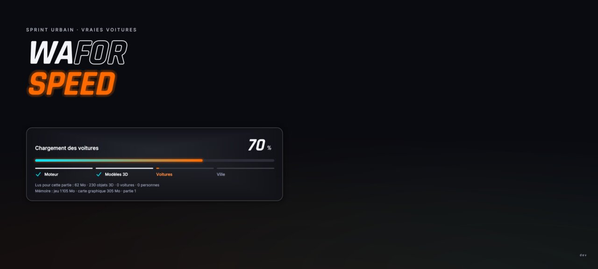 | 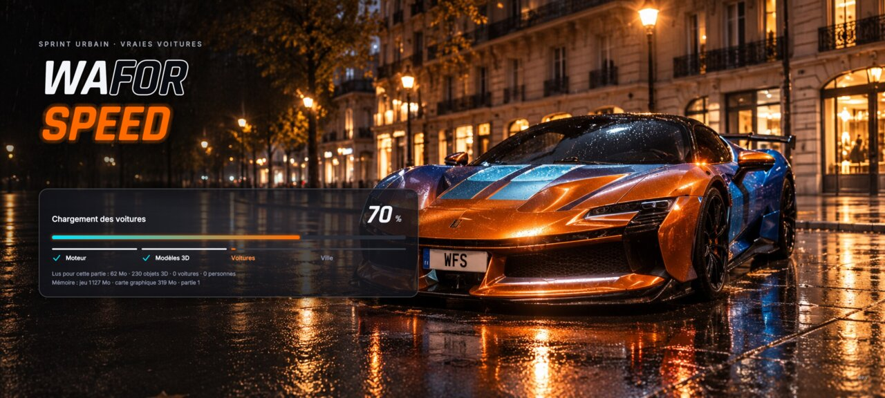 |
